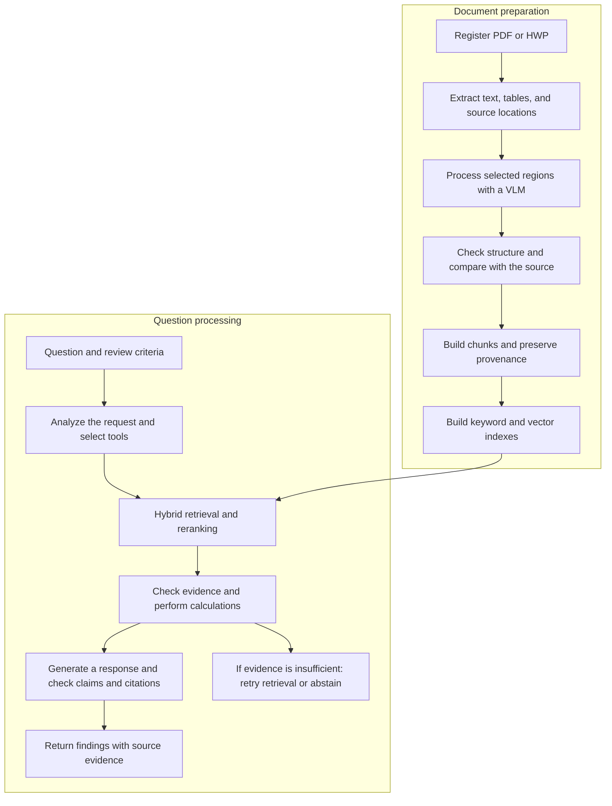

# Report Agent

**A local AI agent for evidence-based report review and decision support**

〖English | [한국어](readme/README-korean.md)〗

〖[Overview](#overview) | [Why Report Agent?](#why-report-agent) | [Workflow](#workflow) | [Roadmap](#roadmap)〗

> Analyze PDF and HWP reports locally, check user-defined review criteria, and provide feedback supported by traceable source evidence.

**Project status:** In development. The capabilities below describe the intended system.

## Overview

Report Agent is a local AI agent for reviewing PDF and HWP reports against user-defined criteria. It connects document understanding, evidence retrieval, numerical checks, and source-backed feedback in a single workflow.

The goal is to help reviewers understand which conditions are met, which are not, and what remains unverified, while keeping the supporting evidence traceable to the original document.

## Why Report Agent?

### Reports that cannot be sent to external services

Internal plans, performance reports, and review materials may contain information that cannot be uploaded to an external service. A workflow that depends on external processing can therefore be unsuitable for these documents.

Report Agent is designed to perform document processing, retrieval, and model inference locally so that review can take place within the user's own environment.

### Figures that lose their meaning during extraction

A figure in a report is defined by its row label, header hierarchy, data year, unit, and footnotes. When these relationships are lost during extraction or chunking, relevant-looking text can support an incorrect comparison.

Report Agent aims to preserve these relationships and their source locations throughout processing and retrieval, including complex tables and document regions that require visual interpretation.

### Review criteria that require more than a summary

Reviewers often need to check whether a report satisfies explicit conditions, compare values across sections, or establish whether the available evidence is sufficient. A summary or a relevant search result alone does not complete these checks.

Report Agent uses the user's criteria to guide evidence collection, numerical calculations, and review feedback. Its intended output explains both the finding and the evidence used to reach it.

### Findings that must be checked against the source

A fluent answer can still cite a passage that does not support its claim or overlook information needed for a conclusion. Reviewers need to inspect the source and understand the limits of the available evidence.

Report Agent aims to connect claims to source passages and table regions, verify their consistency, and identify missing information. If the evidence remains insufficient, it will abstain and explain what additional material is needed.

## Planned capabilities

| Capability | Intended behavior |
|---|---|
| PDF and HWP processing | Extract text, tables, document structure, and source locations. The HWP parsing or conversion approach will be validated separately. |
| Selective VLM processing | Apply a vision-language model to regions requiring additional interpretation, such as complex headers, tables, and charts. |
| Evidence-preserving structure | Link values to their subjects, years, units, header paths, footnotes, and source locations. |
| Hybrid retrieval | Combine keyword and semantic retrieval, then rerank candidate evidence. |
| Criteria-based review | Analyze the request and use retrieval, source lookup, and calculation tools to check the user's criteria. |
| Verification and abstention | Check claims against cited evidence, retry retrieval within a fixed limit, and abstain when evidence remains insufficient. |

## Workflow

This diagram summarizes the main stages. Retrieval retries will be limited to two additional attempts. If sufficient evidence cannot be obtained, the agent will abstain and explain what remains unresolved. Unverified extraction fields will remain explicitly marked.

## Retrieval and agent design

### Preserve meaning and provenance

- Attach document and section titles to passage chunks.
- Attach table titles, row labels, header paths, data years, units, and footnotes to table records.
- Store search-oriented text alongside the structured source data.
- Keep document versions and source locations traceable.
- Distinguish a report's publication year from the year of a value inside it.

For HWP converted to PDF, source locations should identify the converted file and its version.

### Retrieve supporting evidence

1. Identify the question, selected documents, and confirmed search constraints.
2. Retrieve candidates with BM25 and dense embeddings.
3. Deduplicate and combine ranked lists with reciprocal rank fusion (RRF).
4. Rerank the candidates.
5. Expand table headers, footnotes, or surrounding passages when needed.
6. Return an evidence bundle with source references and extraction status.

Retrieval relevance, extraction verification status, and the final review outcome will be represented separately.

### Use tools for review

| Planned tool | Purpose |
|---|---|
| retrieve_evidence | Retrieve evidence matching the question and confirmed constraints. |
| get_source_context | Inspect the original passage, table headers, or footnotes for a retrieved item. |
| calculate | Perform supported numerical operations with explicit unit rules. |

The agent will check whether evidence matches the requested subject, year, and unit before using it in a calculation or response.

## Team responsibilities

| Area | Responsibility |
|---|---|
| PDF and HWP parsing | Extract content, preserve structure and locations, and define the common document format. |
| VLM research | Compare models and prompts, evaluate difficult document regions, and study selective processing. |
| RAG and agent development — Jeongmin Lee | Build chunking, indexing, retrieval, reranking, request analysis, tool-use logic, and response generation and verification. |
| Harness engineering | Build the shared runtime, state and trace management, execution limits, failure handling, and evaluation automation. |

The RAG and agent role owns the retrieval and review strategies. The harness role provides the shared environment for running, observing, and evaluating those strategies.

## Roadmap

1. **Define the data contract and examples:** agree on parser/VLM outputs and RAG inputs; prepare development questions and reference evidence.
2. **Build the retrieval pipeline:** implement chunking and indexes; compare dense, keyword, hybrid, and reranked retrieval.
3. **Implement review behavior:** connect question analysis, tools, calculations, citation checks, and abstention.
4. **Integrate the harness and evaluate:** collect traces, analyze failures, and automate reproducible comparisons.
5. **Build the interface:** connect local FastAPI services and a Chrome Extension for reviewing results and source evidence.

## Getting started

Environment setup, model preparation, indexing, question execution, and evaluation commands will be added after the repository layout and dependencies are finalized.

The initial development interface will be Python functions and command-line execution.
