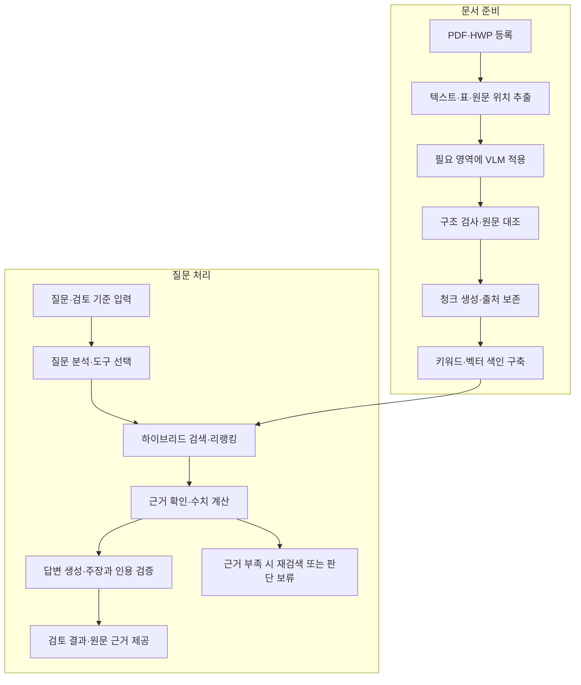

# Report Agent

**원문 근거에 기반한 보고서 검토와 의사결정 지원을 위한 로컬 AI Agent**

〖[English](../README.md) | 한국어〗

〖[개요](#개요) | [프로젝트 필요성](#왜-report-agent가-필요한가) | [파이프라인](#파이프라인) | [개발 로드맵](#개발-로드맵)〗

> PDF·HWP 보고서를 로컬에서 분석하고, 사용자의 검토 기준과 원문 근거에 기반해 의사결정 피드백을 제공합니다.

**프로젝트 상태:** 개발 중입니다. 아래 기능은 구현 목표를 설명합니다.

## 개요

Report Agent는 PDF·HWP 보고서를 사용자의 검토 기준에 따라 분석하는 로컬 AI Agent입니다. 문서 이해, 근거 검색, 수치 검증, 출처에 기반한 피드백을 하나의 흐름으로 연결합니다.

어떤 조건이 충족되었는지, 충족되지 않았는지, 무엇이 미확인 상태인지를 원문 근거와 함께 제시하여 검토자의 판단을 지원하는 것을 목표로 합니다.

## 왜 Report Agent가 필요한가?

### 외부 서비스로 전송하기 어려운 보고서

내부 사업계획서, 실적 보고서, 검토 자료에는 외부 업로드가 제한되는 정보가 포함될 수 있습니다. 외부 서비스에 문서를 전송해야 하는 방식은 이러한 자료를 검토하는 업무에 적용하기 어려울 수 있습니다.

Report Agent는 문서 처리·검색·모델 추론을 로컬에서 수행하도록 설계하여, 사용자의 환경 안에서 보고서를 검토할 수 있도록 합니다.

### 추출 과정에서 의미를 잃는 수치와 표

보고서의 수치는 행 이름, 다중 헤더, 데이터 연도, 단위, 주석이 연결되어야 의미를 갖습니다. 텍스트 추출이나 청킹 과정에서 이 관계가 사라지면 관련 있어 보이는 내용을 찾더라도 잘못된 비교로 이어질 수 있습니다.

Report Agent는 복잡한 표와 시각적 해석이 필요한 영역을 함께 처리하고, 값의 문맥과 원문 위치를 검색 이후에도 유지하는 것을 목표로 합니다.

### 요약만으로 해결되지 않는 검토 업무

검토자는 문서의 핵심 내용을 파악하는 데서 더 나아가, 제시된 조건의 충족 여부를 확인하고 여러 절의 수치를 비교하며 판단에 필요한 근거가 충분한지 살펴야 합니다. 요약이나 관련 문단 검색만으로는 이러한 확인을 끝내기 어렵습니다.

Report Agent는 사용자의 검토 기준에 따라 근거를 모으고 필요한 계산을 수행하여, 검토 결과와 그 이유를 함께 설명하는 피드백을 제공합니다.

### 원문으로 확인할 수 있어야 하는 판단 근거

자연스럽게 작성된 답변도 인용한 문단이 주장을 뒷받침하지 않거나, 결론에 필요한 정보를 빠뜨릴 수 있습니다. 검토자는 답변이 어떤 자료에 기반했으며 어디까지 확인되었는지 직접 살펴볼 수 있어야 합니다.

Report Agent는 주장과 원문 문단·표 영역을 연결하고 정합성을 확인하며, 부족한 정보를 명시하는 것을 목표로 합니다. 근거가 충분하지 않으면 판단을 보류하고 추가로 필요한 자료를 안내합니다.

## 주요 개발 기능

| 기능 | 구현 목표 |
|---|---|
| PDF·HWP 문서 처리 | 텍스트·표·문서 구조·원문 위치를 추출합니다. HWP 파싱 또는 변환 방식은 별도로 검증합니다. |
| 선택적 VLM 활용 | 복잡한 헤더·표·그래프 등 추가 해석이 필요한 영역에 VLM을 적용합니다. |
| 출처를 보존하는 구조화 | 값에 대상·연도·단위·헤더 경로·주석·원문 위치를 연결합니다. |
| 하이브리드 검색 | 키워드 검색과 의미 검색을 결합하고 후보 근거를 리랭킹합니다. |
| 검토 기준 기반 Agent | 질문을 분석하고 검색·원문 조회·계산 도구로 사용자의 조건을 확인합니다. |
| 검증과 판단 보류 | 주장과 인용을 대조하고, 정해진 한도 내에서 재검색하며, 근거가 부족하면 판단을 보류합니다. |

## 파이프라인

주요 처리 단계를 요약한 모식도입니다. 추가 재검색은 최대 2회로 제한하고, 필요한 근거를 확보하지 못하면 판단을 보류하며 미확인 사항을 설명합니다. 검증되지 않은 추출 필드는 해당 상태를 명시적으로 유지합니다.

## RAG 및 Agent 설계

### 의미와 출처 보존

- 문단 청크에 문서 제목과 절 제목을 연결합니다.
- 표 레코드에 표 제목·행 이름·헤더 경로·데이터 연도·단위·주석을 연결합니다.
- 검색용 텍스트와 구조화된 원본 데이터를 함께 저장합니다.
- 문서 버전과 원문 위치를 추적할 수 있도록 유지합니다.
- 보고서 발행연도와 보고서 안에 있는 값의 연도를 구분합니다.

HWP를 PDF로 변환한 경우에는 출처 정보에 변환된 파일과 해당 버전을 명시합니다.

### 근거 검색

1. 질문, 검색할 문서 범위, 확인된 검색 조건을 파악합니다.
2. BM25와 임베딩 기반 검색으로 후보를 수집합니다.
3. 중복을 제거하고 RRF로 검색 순위를 통합합니다.
4. 후보를 리랭킹합니다.
5. 필요한 표 헤더·주석·주변 문단을 보충합니다.
6. 출처와 추출 상태를 포함한 근거 묶음을 반환합니다.

검색 관련성, 추출 검증 상태, 최종 검토 결과는 서로 구분하여 관리합니다.

### 검토 도구 활용

| 개발 예정 도구 | 역할 |
|---|---|
| retrieve_evidence | 질문과 확인된 조건에 맞는 근거를 검색합니다. |
| get_source_context | 검색된 근거의 원문·표 헤더·주석을 조회합니다. |
| calculate | 지원하는 수치 연산과 명시된 단위 규칙에 따라 계산합니다. |

Agent는 근거의 대상·연도·단위가 질문과 일치하는지 확인한 뒤 계산과 답변에 활용합니다.

## 팀 역할

| 담당 영역 | 주요 작업 |
|---|---|
| PDF·HWP 파싱 | 내용 추출, 구조·위치 보존, 공통 문서 형식 정의 |
| VLM 연구 | 모델·프롬프트 비교, 어려운 문서 영역 평가, 선택적 처리 전략 연구 |
| RAG·Agent 개발 — 이정민 | 청킹·색인·검색·리랭킹, 질문 분석, 도구 활용 로직, 답변 생성·검증 |
| 하네스 엔지니어링 | 공통 실행 구조, 상태·실행 기록 관리, 실행 제한, 실패 처리, 평가 자동화 |

RAG·Agent 담당자는 검색과 검토 전략을 구현하고, 하네스 담당자는 해당 전략을 실행·관찰·평가할 수 있는 공통 환경을 구성합니다.

## 개발 로드맵

1. **데이터 형식과 샘플 정의:** 파싱·VLM 출력과 RAG 입력 형식을 합의하고, 개발용 질문과 정답 근거를 준비합니다.
2. **검색 파이프라인 구축:** 청킹·색인을 구현하고 벡터·키워드·하이브리드 검색과 리랭킹을 비교합니다.
3. **검토 기능 구현:** 질문 분석, 도구 호출, 수치 계산, 인용 검증, 판단 보류를 연결합니다.
4. **하네스 통합과 평가:** 실행 기록을 수집하고 실패를 분석하며 재현 가능한 비교를 자동화합니다.
5. **사용자 화면 개발:** 로컬 FastAPI와 Chrome Extension을 연결하여 결과와 원문 근거를 확인하도록 구성합니다.

## 시작하기

저장소 구조와 의존성이 확정되면 환경 설정, 모델 준비, 색인 생성, 질문 실행, 평가 명령을 추가할 예정입니다.

초기에는 Python 함수와 터미널 실행으로 개발합니다.
