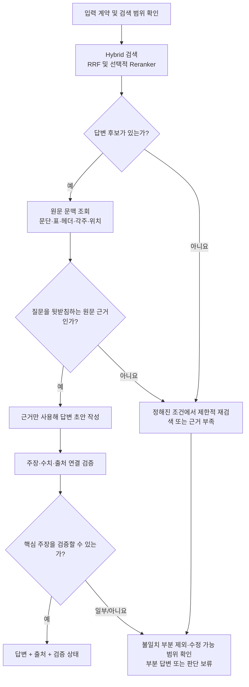
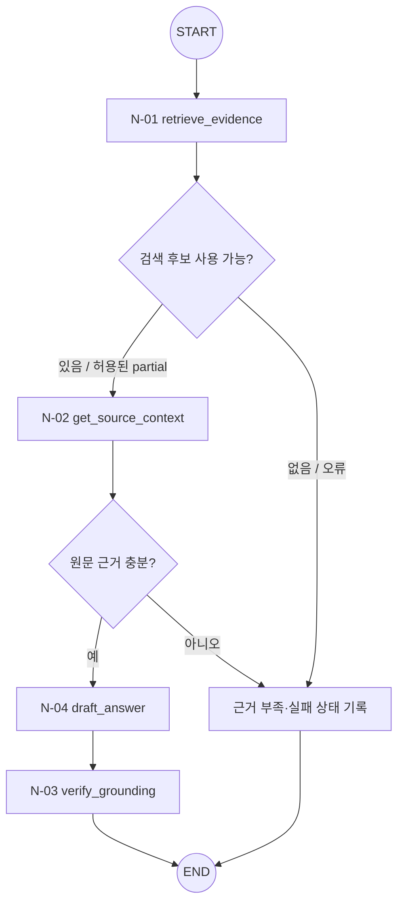

# T-01 · Document QA — 문서 근거 질의응답

> **상태:** MVP 우선, 내부 Small Node 순서와 업무 흐름 1차 설계. 세부 조건부 엣지·재시도 예산·타입은 검토 중.
>
> **상위 구조:** [Query Agent MVP](../query-agent-mvp.md) · [Big Node 목록](README.md).
>
> **외부 입구/출구:** [N-10](../small-nodes/N-10.md) → 이 Big Node → [N-11](../small-nodes/N-11.md). 두 공통 Small Node는 내부 노드 수에 포함하지 않는다.

## 1. 목적·입력·업무별 검증 정책

**목적:** 질문에 해당하는 보고서의 내용을 찾고, 그 내용으로 뒷받침되는 짧고 명료한 답변을 만든다. 단순한 관련 청크 반환이나 문서 전체 요약과는 구별한다.

**입력:** `RoutedTask`의 원본 질문, 허용된 문서 ID/버전, 대상 절·기간 등의 명시적 제약. 질문에 답하는 데 필수적인 대상이 빠졌다면 실행 전에 `needs_clarification`으로 종료한다.

**고정 워크플로(초안)**

| 단계 | 구체적 수행 및 확인 사항 | 보존할 결과(개념) |
|---|---|---|
| Q1. 질문·범위 확인 | 대상 문서/버전, 질문의 대상·시점·제약 확인. 임의의 조건 추가 금지 | `QARequest` 또는 `RoutedTask` 참조 |
| Q2. 검색 | 동일 쿼리로 하이브리드 검색. 최종 검색 전략은 실험 결과에 따라 선택 | `RetrievalCandidates` |
| Q3. 원문 조회·적합성 확인 | 관련성뿐 아니라 질문에 직접 답하는지, 표의 헤더·단위·각주가 맞는지 확인 | 근거 항목별 `source_ref`, 추출·검증 상태 |
| Q4. 답변 초안 | 확인된 정보만 사용하고 정보가 없는 부분은 미확인으로 유지 | `ReviewDraft`, 주장별 근거 참조 |
| Q5. 인용 검증·결과 | 주장마다 근거를 대조. 오류가 있으면 해당 주장 제외 또는 허용된 보정 후 재검사 | `VerificationReport`, QA형 `WorkflowResult` |

**분기·판단 보류:** 검색된 내용이 질문과 관련 있어도 직접적인 답이 아닐 수 있다. 후보가 없거나 수치·시점·원문 위치가 불확실하면 정해진 범위에서만 재조회하고, 여전히 부족하면 `insufficient_evidence`를 반환한다. 일부 주장만 근거가 있으면 그 부분만 설명하고 나머지를 미확인으로 표시한다.

**결과 예시(형태):** 답변 본문, 뒷받침된 주장 목록, 주장별 출처 위치/문서 버전, 생략·미확인 내용, 실행·검증 상태. 문서 전체를 요약하지 않는다.

**평가 후보:** 답변 가능 여부 판단, 주장별 출처 지지율, 사실·숫자 오류율, 근거 부족 시 보류율, 검색 및 전체 실행 지연.

## 2. 사용 Small Node 문서

**기본 실행 순서:** [N-01](../small-nodes/N-01.md) → [N-02](../small-nodes/N-02.md) → [N-04](../small-nodes/N-04.md) → [N-03](../small-nodes/N-03.md)

| 실행 단계 | Small Node 상세 문서 | 역할 | 주요 산출물 |
|---|---|---|---|
| 1 | [N-01](../small-nodes/N-01.md) · `retrieve_evidence` | 검색 후보 탐색 | `RetrievalCandidates` |
| 2 | [N-02](../small-nodes/N-02.md) · `get_source_context` | 후보와 원문·표·헤더·각주·위치 연결 | `EvidenceBundle` |
| 3 | [N-04](../small-nodes/N-04.md) · `draft_answer` | 원문 근거를 이용한 질문 답변 초안 작성 | `ReviewDraft` |
| 4 | [N-03](../small-nodes/N-03.md) · `verify_grounding` | 주장·판정·비교 결과와 원문 근거의 정합성 검사 | `VerificationReport` |

- **N-01은 `RetrievalCandidates`, N-02는 문맥을 더한 `EvidenceBundle`을 반환한다.** 둘의 계약을 섞지 않는다.
- 여러 검토 기준·비교 대상을 처리하는 반복과 취합은 Big Node가 관리한다. 동일 Small Node를 재사용하더라도 Tiny Node를 생성하지 않는다.
- 각 Small Node의 **내부 함수·입출력 타입·오류 처리**는 연결된 `N-xx.md`에만 상세화한다.

## 3. LangGraph 노드·조건부 엣지 (설계안)

**도식 설명:** `N-xx`만 Small Node다. 분기 마름모는 조건부 Edge이고 '상태 기록' 박스는 별도 Small Node가 아닌 그래프 상태 처리다. START/END는 LangGraph의 특수 노드다.

**N-01 이후 분기:** 검색 후보가 있고 정상 결과(또는 허용된 `partial` 결과)일 때만 N-02를 호출한다. 후보 없음·실패는 근거 부족/오류로 처리하며, 재검색이 필요해도 사전 합의한 제한 조건 안에서만 수행한다. **상위 Big Node가 다음 노드를 정하고 N-01은 N-02를 직접 호출하지 않는다.**

## 4. 결과 계약과 미정 사항

- `WorkflowResult`에 업무별 결과, 원문 참조·문서 버전·검증 상태·미확인 원인·실행 오류를 연결한다.
- 검색 누락만으로 정보 부재를 확정하지 않고, 수치/인용/비교 가능성도 검증되지 않았다면 보류한다.
- 세부 상태값·임계값·재시도 횟수·테스트·실행 코드의 확정은 후속 설계 항목이다.
