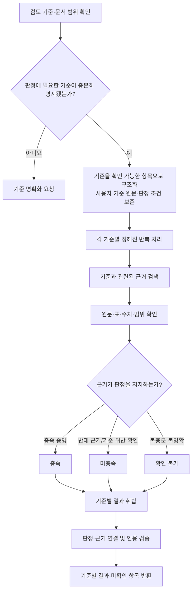
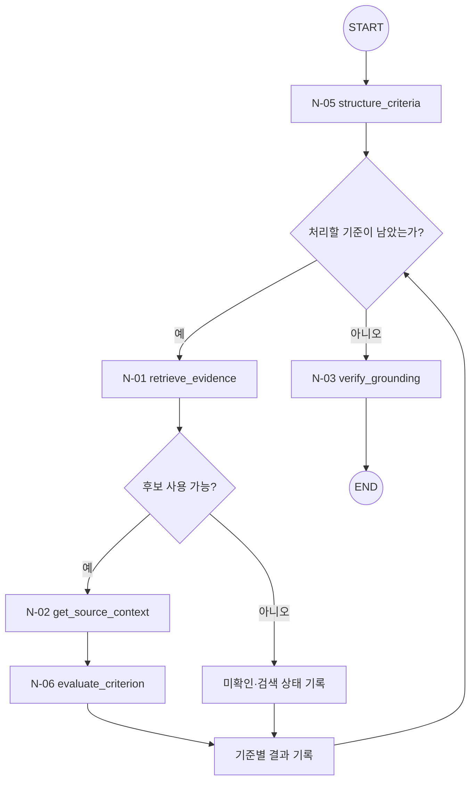

# T-02 · Criteria Review — 명시적 기준 충족 검토

> **상태:** MVP 우선, 내부 Small Node 순서와 업무 흐름 1차 설계. 세부 조건부 엣지·재시도 예산·타입은 검토 중.
>
> **상위 구조:** [Query Agent MVP](../query-agent-mvp.md) · [Big Node 목록](README.md).
>
> **외부 입구/출구:** [N-10](../small-nodes/N-10.md) → 이 Big Node → [N-11](../small-nodes/N-11.md). 두 공통 Small Node는 내부 노드 수에 포함하지 않는다.

## 1. 목적·입력·업무별 검증 정책

**목적:** 사용자가 제공한 검토 기준을 항목별로 확인해 **충족 / 미충족 / 확인 불가**를 각각 판정한다. 단순 정보 조회와 달리 기준의 조건·임계값·확인 범위가 판정의 핵심이다.

**입력:** 원본 질문, **사용자 또는 입력 서식이 명시한 검토 기준**, 문서 범위·버전, 필요한 평가 시점과 대상. 기준이 제공되지 않거나 필수 조건의 의미가 불명확하면 임의의 평가 기준을 생성하지 않고 명확화를 요청한다.

**고정 워크플로(초안)**

| 단계 | 구체적 수행 및 확인 사항 | 보존할 결과(개념) |
|---|---|---|
| C1. 기준 검증·구조화 | 사용자 기준을 누락·변경 없이 조건별 항목으로 구성. 수치 임계값, 시점, 범위, 예외 조건을 구별 | `CriteriaSet`(항목 ID·원문·판정 조건) |
| C2. 기준별 검색 | 각 명시적 항목의 원문 조건을 검색 입력으로 활용. 기준별 서로 다른 근거 참조 허용 | 기준별 `EvidenceBundle` 참조 |
| C3. 원문 대조 | 조건을 지지·반박하는 자료와 추출 오류·단위 차이를 확인 | 기준별 지지·반박 근거 및 검증 상태 |
| C4. 항목 판정 | 조건 충족은 직접 근거 필요. 미충족은 위반을 입증하는 자료 또는 범위가 확인된 완전성 검사 필요 | `CriterionFinding`(상태·판정 이유·근거) |
| C5. 검증·집계 | 판정과 인용 정합성 확인. 전체 통과 여부는 사용자가 지정한 집계 규칙이 있을 때만 산출 | `VerificationReport`, Criteria형 `WorkflowResult` |

**특별 규칙:** **검색 결과에 안 나온다는 이유만으로 '미충족' 판정하지 않는다.** 예를 들어 "문서에 목표 수치가 없다"는 부재 주장은 대상 전체를 확인할 수 있는 방법과 검사 범위가 확보된 경우에만 인정한다. 단순 Top-k 검색으로 찾지 못했다면 `확인 불가`다.

**질의 증폭과의 경계:** 사용자가 제시한 평가 조건을 **검증 항목으로 분리**하는 것은 업무 판정 절차다. 새로운 의미의 질문을 여러 개 생성해 검색하는 Multi-query/PRF/HyDE와 구별하며, 기존 H-12 백로그의 도입 결정을 변경하지 않는다.

**결과 예시(형태):** 평가 기준 ID/원문, 각 항목의 충족·미충족·확인 불가, 근거 및 반증 위치, 미확인 이유, 사용자 정의 집계 조건에 따른 결과(있는 경우).

**평가 후보:** 기준별 판정 정확도, 충족·미충족·보류의 혼동, 근거 지지율, 누락·부재를 과도하게 확정하는 비율, 조건 수에 따른 실행 지연.

## 2. 사용 Small Node 문서

**기본 실행 순서:** [N-05](../small-nodes/N-05.md) → [N-01](../small-nodes/N-01.md) → [N-02](../small-nodes/N-02.md) → [N-06](../small-nodes/N-06.md) → [N-03](../small-nodes/N-03.md)

| 실행 단계 | Small Node 상세 문서 | 역할 | 주요 산출물 |
|---|---|---|---|
| 1 | [N-05](../small-nodes/N-05.md) · `structure_criteria` | 명시된 검토 기준을 판정 항목으로 구조화 | `CriteriaSet` |
| 2 | [N-01](../small-nodes/N-01.md) · `retrieve_evidence` | 검색 후보 탐색 | `RetrievalCandidates` |
| 3 | [N-02](../small-nodes/N-02.md) · `get_source_context` | 후보와 원문·표·헤더·각주·위치 연결 | `EvidenceBundle` |
| 4 | [N-06](../small-nodes/N-06.md) · `evaluate_criterion` | 기준별 충족·미충족·확인 불가 판정 | `CriterionFinding` |
| 5 | [N-03](../small-nodes/N-03.md) · `verify_grounding` | 주장·판정·비교 결과와 원문 근거의 정합성 검사 | `VerificationReport` |

- **N-01은 `RetrievalCandidates`, N-02는 문맥을 더한 `EvidenceBundle`을 반환한다.** 둘의 계약을 섞지 않는다.
- 여러 검토 기준·비교 대상을 처리하는 반복과 취합은 Big Node가 관리한다. 동일 Small Node를 재사용하더라도 Tiny Node를 생성하지 않는다.
- 각 Small Node의 **내부 함수·입출력 타입·오류 처리**는 연결된 `N-xx.md`에만 상세화한다.

## 3. LangGraph 노드·조건부 엣지 (설계안)

**도식 설명:** `N-xx`만 Small Node다. 분기 마름모는 조건부 Edge이고 '상태 기록' 박스는 별도 Small Node가 아닌 그래프 상태 처리다. START/END는 LangGraph의 특수 노드야.

**N-01 이후 분기:** 검색 후보가 있고 정상 결과(또는 허용된 `partial` 결과)일 때만 N-02를 호출한다. 후보 없음·실패는 근거 부족/오류로 처리하며, 재검색이 필요해도 사전 합의한 제한 조건 안에서만 수행한다. **상위 Big Node가 다음 노드를 정하고 N-01은 N-02를 직접 호출하지 않는다.**

## 4. 결과 계약과 미정 사항

- `WorkflowResult`에 업무별 결과, 원문 참조·문서 버전·검증 상태·미확인 원인·실행 오류를 연결한다.
- 검색 누락만으로 정보 부재를 확정하지 않고, 수치/인용/비교 가능성도 검증되지 않았다면 보류한다.
- 세부 상태값·임계값·재시도 횟수·테스트·실행 코드의 확정은 후속 설계 항목이다.
