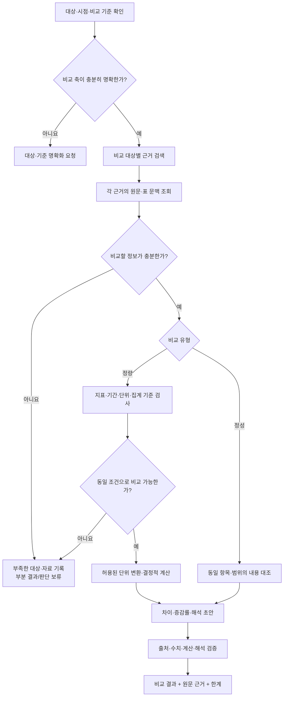
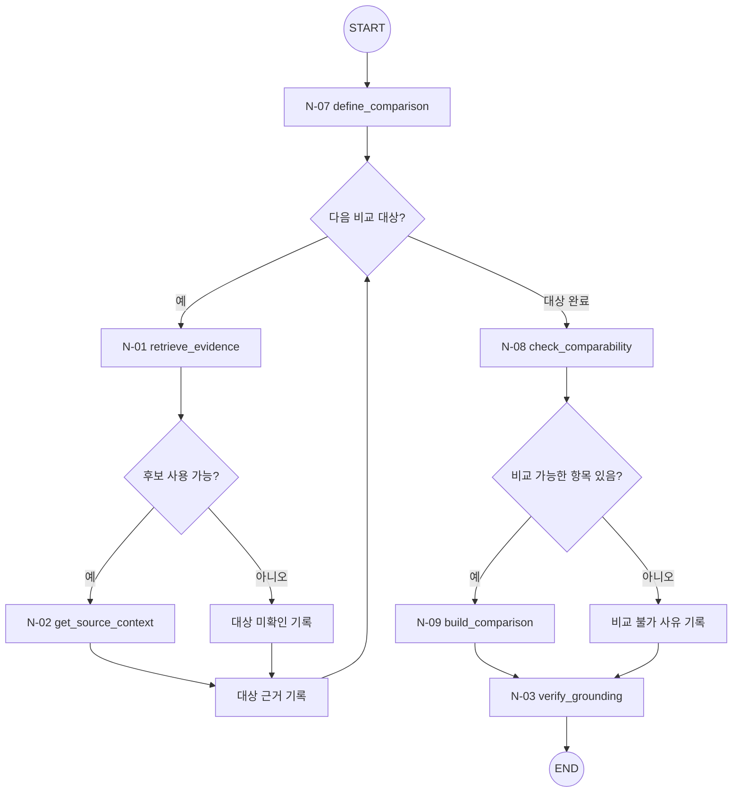

# T-03 · Comparative Analysis — 문서·기간·지표 비교

> **상태:** MVP 우선, 내부 Small Node 순서와 업무 흐름 1차 설계. 세부 조건부 엣지·재시도 예산·타입은 검토 중.
>
> **상위 구조:** [Query Agent MVP](../query-agent-mvp.md) · [Big Node 목록](README.md).
>
> **외부 입구/출구:** [N-10](../small-nodes/N-10.md) → 이 Big Node → [N-11](../small-nodes/N-11.md). 두 공통 Small Node는 내부 노드 수에 포함하지 않는다.

## 1. 목적·입력·업무별 검증 정책

**목적:** 사용자 지정 두 대상 이상을 **동일한 비교 기준**에서 정성적 또는 정량적으로 비교한다. 수치 계산은 검증된 값을 대상으로 결정적으로 실행하고, 인과관계나 개선·악화의 판단에는 별도 근거 또는 사용자 기준이 필요하다.

**입력:** 비교 대상(문서/기간/절/항목), 허용 문서·버전, 비교 지표 또는 질문, 사용자가 명시한 평가 기준. 비교 대상이나 지표가 불명확하면 임의로 정하지 않는다.

**고정 워크플로(초안)**

| 단계 | 구체적 수행 및 확인 사항 | 보존할 결과(개념) |
|---|---|---|
| A1. 비교 축 확인 | 주체·문서 버전·기간·지표·계산 기준·분석 범위를 식별 | `ComparisonSpec`(대상 및 비교 축) |
| A2. 근거 확보 | 각 대상에 대해 같은 기준으로 근거 검색, 표·문단·출처 조회 | 대상별 `EvidenceBundle`, `source_ref` |
| A3. 비교 가능성 검증 | 숫자일 경우 단위·기준 기간·집계 범위·동일 지표 여부 확인. 텍스트일 경우 동일 항목의 의미·범위 확인 | 비교 가능/불가능 사유와 원문 값 |
| A4. 계산·비교 | 검증된 값에 대해서만 차이·증감률 등을 결정적으로 계산. 정성 비교는 각 대상의 명시적 내용에서 공통점·차이점 추출 | `CalculationResult` 또는 정성 비교 항목 |
| A5. 해석·검증 | 수치·계산·인용 재확인. 개선·악화의 기준 및 인과 설명은 명시된 근거가 있는지 별도 확인 | `ComparisonFinding`, `VerificationReport`, Comparison형 `WorkflowResult` |

**비교 불가능 상태:** 한쪽의 자료가 없거나 기간·단위·집계 기준이 다르고 검증된 환산 방법도 없다면 억지로 비교하지 않는다. 가능한 항목만 부분 반환하거나 비교 불가 이유를 함께 전달한다.

**수치 해석 제한:** 0을 기준값으로 사용하는 증감률 등 정의되지 않는 연산은 계산 오류가 아니라 **비교 조건상 계산 불가**로 표시한다. 단위 변경은 명시적이고 검증 가능한 경우에만 허용하고, 서로 다른 통화·물가 기준 등의 외부 변환 기준은 임의로 생성하지 않는다.

**원인 질문 처리:** "왜 증가했는가?"는 값의 증가 자체로부터 인과관계를 추론하지 않는다. 문서에 원인 설명이 직접 제시되면 이를 출처와 함께 서술하고, 그렇지 않으면 **증감은 확인됐지만 원인은 미확인**으로 구분한다.

**결과 예시(형태):** 비교 축, 대상별 원문 값·위치, 정량 계산 또는 정성 항목별 차이, 비교 가능성, 확인된 설명과 미확인 사항, 검증 상태.

**평가 후보:** 대상/기간 추출 정확도, 원문 수치 일치율, 단위·집계 불일치 검출, 계산 정확도, 인과 과잉추론 빈도, 부분 결과 판단 적절성.

## 2. 사용 Small Node 문서

**기본 실행 순서:** [N-07](../small-nodes/N-07.md) → [N-01](../small-nodes/N-01.md) → [N-02](../small-nodes/N-02.md) → [N-08](../small-nodes/N-08.md) → [N-09](../small-nodes/N-09.md) → [N-03](../small-nodes/N-03.md)

| 실행 단계 | Small Node 상세 문서 | 역할 | 주요 산출물 |
|---|---|---|---|
| 1 | [N-07](../small-nodes/N-07.md) · `define_comparison` | 문서·기간·지표·범위 및 비교 축 정의 | `ComparisonSpec` |
| 2 | [N-01](../small-nodes/N-01.md) · `retrieve_evidence` | 검색 후보 탐색 | `RetrievalCandidates` |
| 3 | [N-02](../small-nodes/N-02.md) · `get_source_context` | 후보와 원문·표·헤더·각주·위치 연결 | `EvidenceBundle` |
| 4 | [N-08](../small-nodes/N-08.md) · `check_comparability` | 기간·단위·집계 조건과 정성 비교 범위 검사 | `비교 가능성·사유(타입 미정)` |
| 5 | [N-09](../small-nodes/N-09.md) · `build_comparison` | 정량 계산 또는 정성 비교 결과 구성 | `ComparisonFinding` |
| 6 | [N-03](../small-nodes/N-03.md) · `verify_grounding` | 주장·판정·비교 결과와 원문 근거의 정합성 검사 | `VerificationReport` |

- **N-01은 `RetrievalCandidates`, N-02는 문맥을 더한 `EvidenceBundle`을 반환한다.** 둘의 계약을 섞지 않는다.
- 여러 검토 기준·비교 대상을 처리하는 반복과 취합은 Big Node가 관리한다. 동일 Small Node를 재사용하더라도 Tiny Node를 생성하지 않는다.
- 각 Small Node의 **내부 함수·입출력 타입·오류 처리**는 연결된 `N-xx.md`에만 상세화한다.

## 3. LangGraph 노드·조건부 엣지 (설계안)

**도식 설명:** `N-xx`만 Small Node다. 분기 마름모는 조건부 Edge이고 '상태 기록' 박스는 별도 Small Node가 아닌 그래프 상태 처리다. START/END는 LangGraph의 특수 노드야.

**N-01 이후 분기:** 검색 후보가 있고 정상 결과(또는 허용된 `partial` 결과)일 때만 N-02를 호출한다. 후보 없음·실패는 근거 부족/오류로 처리하며, 재검색이 필요해도 사전 합의한 제한 조건 안에서만 수행한다. **상위 Big Node가 다음 노드를 정하고 N-01은 N-02를 직접 호출하지 않는다.**

## 4. 결과 계약과 미정 사항

- `WorkflowResult`에 업무별 결과, 원문 참조·문서 버전·검증 상태·미확인 원인·실행 오류를 연결한다.
- 검색 누락만으로 정보 부재를 확정하지 않고, 수치/인용/비교 가능성도 검증되지 않았다면 보류한다.
- 세부 상태값·임계값·재시도 횟수·테스트·실행 코드의 확정은 후속 설계 항목이다.
