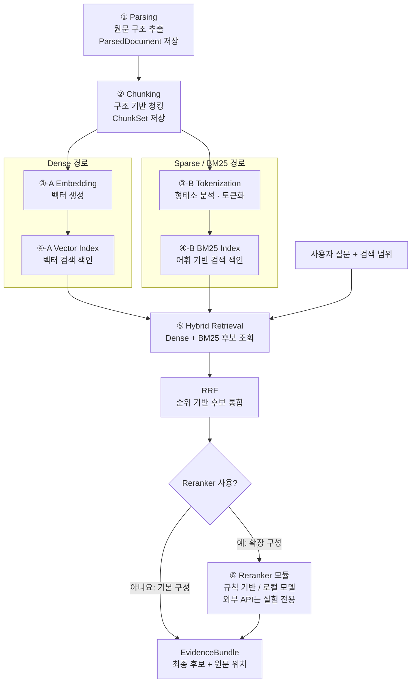

# 문서 처리·하이브리드 검색 파이프라인 (러프 설계)

> 상태: 구조 및 저장 데이터의 1차 설계. 기술 스택·모델·세부 파라미터·구현은 미확정.
>
> 목적: 문서군·기관·데이터셋에 독립적인 로컬 처리 구조를 만들고, 각 단계의 출력을 저장해 재사용·비교·실패 추적 가능하게 한다.
>
> 설계 경계: **파싱 → 청킹 → (Dense 임베딩 / BM25 토큰화) → 각각의 색인 → Hybrid + RRF → 선택적 Reranker → EvidenceBundle**. RAG 답변 생성·사실 검증은 후속 단계로 분리한다.

## 1. 파이프라인 구조

**①~④는 문서 등록·갱신 시 생성되는 색인 준비 단계이고, ⑤~⑥은 질의 시 실행한다.** RRF의 출력은 Reranker 유무와 관계없이 보존한다. 질문도 색인에 사용한 임베딩 모델·BM25 분석기와 호환되도록 준비한다.

**기본 구성(항상 동작):** Dense 검색 + BM25 검색 → **RRF**(순위 기반 후보 통합) → EvidenceBundle. 외부 API나 추가 모델 호출 없이 동작하는 로컬 기준선이다.

**확장 구성(선택):** 같은 RRF 후보 집합 → 교체 가능한 **Reranker** → EvidenceBundle. Reranker 구현은 규칙 기반, 로컬 Cross-Encoder, 추후 다른 로컬 모델 등을 포함할 수 있다. **Voyage API는 제품의 기본 구성요소가 아닌 외부 비교 실험용 어댑터 아이디어**로 한정한다.

**RRF와 PRF는 서로 다르다.** RRF(Reciprocal Rank Fusion)는 검색 결과의 순위를 결합하는 방법이고, PRF(Pseudo-Relevance Feedback)는 상위 검색 결과를 가상 관련 문서로 보고 질의를 확장·수정해 다시 검색하는 별도 방법이다. 이번 기본 구성은 **RRF**로 정리하며 PRF는 채택하지 않았다.

여기서 'Sparse / BM25'는 **토큰화에 따른 전통적인 어휘 검색**을 뜻한다. 학습 기반 sparse 임베딩(SPLADE 등)을 채택했다는 의미가 아니다. BM25는 형태소 분석이 필수는 아니지만 한국어 분석을 위한 독립 Tokenization 단계로 분리한다.

## 2. 입력 (문서 파일)

| 구분 | 입력 | 처리 원칙 |
|---|---|---|
| 기본 문서 파일 | PDF, HWP 및 지원이 검증된 추가 형식(HWPX 등) | 형식별 파서를 교체 가능하게 구성. 실제 지원 범위는 파서 선정 후 확정 |
| 내용 | 본문, 표, 이미지, 차트, 도형, 수식, 레이아웃 | 추출할 수 없는 요소도 원문 위치·미지원/미검증 상태를 가급적 보존 |
| 문서 메타데이터 | 원본 파일 참조, 확인한 형식, 파일 크기, 내용 해시 | 파일명이나 특정 기관·분야 이름을 로직 분기 조건으로 사용하지 않음 |
| 선택적 처리 설정 | 파서·청킹·토큰화·임베딩·색인 설정 | 문서 내용과 독립된 설정 및 버전으로 기록 |

원문은 로컬에서 관리한다. 모델별·색인별 반복 처리를 위해 동일 파일을 임의로 복제하거나 원문 텍스트를 모든 실행 로그에 중복 기록하지 않는다.

**질의 시 추가 입력:** 검색 질문(`query`), 사용자가 허용한 문서/버전 범위, 선택적 검토 기준. 문서 등록 입력과 혼동하지 않는다.

## 3. 출력 및 저장 (저장할 데이터)

| 단계 | 산출물(개념명) | 저장할 필수 데이터 | 선택적·후속 데이터 |
|---|---|---|---|
| ① Parsing | `DocumentManifest`, `ParsedDocument` | `document_id`, 원문 해시·형식·버전, `block_id`, 요소 종류·순서·추출 내용, 원문 위치, 파서·설정 버전, 추출 상태 | TableIR(셀·병합·헤더 추정), 이미지/도형 영역 참조, OCR·VLM 보완 결과·검증 상태 |
| ② Chunking | `ChunkSet` | `chunk_id`, `document_id`, 참조한 `block_id`와 원문 위치, 청크 원문/검색용 표현, 청킹 설정·버전, 입력·출력 해시 | 표의 행 라벨·상위 열 헤더·각주 연결, 색인용/LLM용/검증용 표현 구분 |
| ③-A Embedding | `EmbeddingArtifact` | `chunk_id`, 벡터 데이터 또는 `vector_ref`, 임베딩 모델 ID·정확한 버전, 차원, 입력 텍스트 해시, 전처리·정규화·지시문 설정 | 배치 ID, 연산 장치, 생성 시간 및 자원 사용량 |
| ④-A Vector Index | `VectorIndexManifest` | 색인 버전·저장 위치, 임베딩 집합 해시, 벡터 차원, 거리 함수/인덱스 설정, `chunk_id` 대응 관계 | 인덱스별 성능·메모리 측정 |
| ③-B Tokenization | `LexicalCorpus` | `chunk_id`, 원본 검색 텍스트 참조, 분석·정규화된 토큰 목록, 토큰화 규칙·분석기/사전 버전, 입력 해시 | 품사 정보, 토큰 위치, 숫자·영문·기호 보존 관련 진단 |
| ④-B BM25 Index | `BM25IndexManifest` 및 실제 색인 | 색인 버전·저장 위치, 토큰화된 코퍼스 해시, `chunk_id` 매핑, BM25 구현·파라미터(`k1`, `b` 등), 색인 건수 | 문서별 TF·길이, 토큰별 DF/IDF, 평균 문서 길이 등 통계(엔진이 관리할 수도 있음) |
| ⑤ Hybrid + RRF (기본) | `FusionResult` / `RetrievalCandidates` | 질의 ID·해시, 대상 문서/색인 버전, 후보 `chunk_id`, Dense·BM25 개별 순위·점수, RRF 순위·설정, 후보 집합 해시 | 검색 엔진·질의 처리 시간, 후보별 원문 위치 |
| ⑥ Reranker (선택) | `RerankResult` | 입력 후보 집합의 해시·순서, 구현/모델 ID·버전, 재평가 점수·최종 순위, `chunk_id`, 실행·오류·건너뜀 상태 | 규칙·지시문·입력 표현 버전, 토큰·지연·비용, 외부 API 여부 |
| 검색 결과 전달 | `EvidenceBundle` | 최종 후보와 원본 `chunk_id`, `document_id`, 블록·표/헤더/각주 및 원문 위치 참조, 적용한 검색·재랭킹 전략 버전 | 추가 원문 문맥 확장, 근거 검증/미확인 상태 |

**공통 저장 규칙:**
- 데이터가 큰 원문·이미지·벡터·색인 본체는 별도 로컬 저장소에 보관하고, 하네스 실행 상태에는 **아티팩트 ID/버전/해시/위치 참조**를 기록한다.
- **아티팩트(재사용 가능한 결과)**, **체크포인트(실행 재개 상태)**, **트레이스(실행 관찰 기록)**는 목적이 달라 논리적으로 분리한다.
- `chunk_id`는 양쪽 색인에서 동일한 원본 청크를 가리킨다. 문서·청킹 버전이 달라지면 ID 또는 색인 계보를 통해 혼동을 방지한다.
- RRF 결과를 기준선으로 항상 보존하고, Reranker 결과는 별도 아티팩트로 관리한다. **리랭커가 첫 검색에서 누락된 문서를 새로 발견하는 것은 아니므로** 최초 후보 집합과 최종 순위를 구별한다.
- 검색 엔진 내부 통계가 충분히 영속화되는 경우 TF/DF를 별도 파일로 중복 저장할 필요는 없다. **재현 가능한 토큰화 설정·코퍼스 스냅샷·색인 버전**을 확보하는 것이 목적이다.
- 내용 기반 캐시는 입력 해시와 관련 모델·분석기·설정·스키마 버전으로 유효성을 판단한다. 문서명이 같다는 이유만으로 재사용하지 않는다.
- 특정 라이브러리나 데이터셋 전용 스키마에 의존하지 않으며, 로컬·상업적 사용 및 오픈소스 재배포 적합성은 선정 시 별도 확인한다.

## 4. 단계별 설명

**① Parsing — 원문 구조 보존.** PDF/HWP에서 텍스트, 표, 원문 위치, 시각적 영역을 추출한다. 추출이 끝났다는 사실과 내용의 의미가 정확하다는 판단을 구분한다. 파서 교체 시에도 동일한 구조 계약을 유지한다. 자세한 경계는 [파싱 설계](parsing-stage.md)를 참조한다.

**② Chunking — 검색 단위 형성.** 단순 길이 분할보다는 문단·표·섹션 관계를 가능한 범위에서 보존한다. 특히 표의 값이 어떤 행 라벨·열 헤더·각주와 연결되는지 참조를 유지한다. 한 청크에서 임베딩용 표현과 BM25용 표현을 별도로 만들 수도 있지만, 그 원본 출처는 동일한 `chunk_id`로 추적한다.

**③-A/④-A Dense — 의미 기반 검색 준비.** 청크의 검색용 텍스트를 로컬 임베딩 모델로 벡터화하고 색인한다. 모델 또는 임베딩 설정만 달라질 경우 파싱·청킹 결과를 재사용할 수 있도록 한다.

**③-B/④-B Sparse — 어휘 기반 검색 준비.** 청크 텍스트를 토큰화하고 BM25 색인을 만든다. 한국어 형태소 분석기 후보를 비교하되 명사만 남기는 규칙이 부정 표현·수치·영문 약어를 삭제하지 않는지 주의한다. 분석기만 바뀌면 Dense 임베딩을 재생성할 필요가 없도록 한다.

**⑤ Hybrid Retrieval + RRF — 기본 구성.** Dense와 BM25 후보를 조회하고, 동일한 `chunk_id`를 기준으로 중복을 식별한 후 RRF로 순위를 결합한다. RRF는 각 검색기의 원점수가 아니라 **순위**로 점수를 계산하므로 정규화되지 않은 Dense/BM25 점수를 직접 더하지 않는다. 가중 RRF는 비교 아이디어로만 남기고 초기 기본값과 성능 우열은 미확정이다.

**⑥ Reranker — 선택적·교체형 확장.** 질문과 상위 후보 텍스트(필요한 경우 표의 헤더·행 라벨 포함)를 입력받아 후보를 재정렬한다. 구현 후보는 **규칙 기반 재정렬, 로컬 Cross-Encoder, 다른 로컬 모델**이며, 외부 API는 실험 한정이다. 재랭킹이 없더라도 ⑤에서 곧바로 결과를 반환한다. 리랭커 점수는 '질문 관련성'이지 **인용·원문 숫자의 사실 검증 결과가 아니다.**

**EvidenceBundle — 검토 Agent로 전달.** 기본·확장 구성 모두 같은 출력 계약을 사용한다. 순위가 바뀌더라도 원문 블록·표 구조·각주 및 출처 위치를 추적 가능하게 보존한다.

## 5. 변경 시 재사용·무효화 범위

| 변경 항목 | 다시 처리해야 하는 대표 단계 |
|---|---|
| 파서·원문 내용 변경 | 변경된 파싱 결과 및 해당 결과에 의존하는 청킹·두 검색 경로 |
| 청킹 전략·검색 표현 변경 | 변경된 청크에 대해 두 검색 경로의 토큰·임베딩 및 색인 |
| 형태소 분석기·사전/정규화 규칙 변경 | Tokenization → BM25 Index |
| 임베딩 모델·차원/입력 설정 변경 | Embedding → Vector Index |
| BM25 `k1`/`b`, 검색 색인 설정 변경 | 해당 BM25 색인 또는 질의 설정(엔진 구현에 따라 다름) |
| RRF 상수·가중치 변경 | 저장된 Dense/BM25 검색 결과의 순위 재결합(후보가 같다면 원문 재색인 불필요) |
| Reranker 모델·규칙·설정 변경 | 저장된 RRF 후보를 입력으로 재평가. 인덱스 재구축 불필요 |

개별 검색 점수의 척도가 달라 Dense 유사도와 BM25 점수를 그대로 더하지 않는다. **RRF는 원점수 대신 순위를 합치는 기본 후보**이며, 검색 품질이 항상 개선된다는 전제는 두지 않는다. 최종 결정은 별도 평가 결과를 기준으로 한다.

## 6. Reranker 구조 및 외부 기준선 아이디어

### 6.1 두 실행 구성

| 구성 | 실행 경로 | 의도 |
|---|---|---|
| **A. 기본** | Hybrid(Dense+BM25) → **RRF** → EvidenceBundle | 추가 리랭커 없는 완전 로컬 기준선 |
| **B. 확장** | 동일 Hybrid + RRF 후보 → **선택한 Reranker 구현** → EvidenceBundle | 별도 모듈의 정확도·지연·메모리·비용 영향을 비교 |

Reranker는 강제 단계가 아니다. 실패·시간 초과·비활성화 시에는 오류를 기록하고, 운영 정책이 허용하면 **기본 RRF 결과로 폴백**한다. 로컬 환경·민감 문서·기업 배포에는 외부 API 사용을 요구하지 않는다.

### 6.2 Voyage reranker 외부 평가 베이스라인 — 아이디어 / 미확정

**목적:** 상용 API Reranker의 결과를 외부 **품질 비교 기준점(reference)** 으로 설정하고, 향후 로컬 Reranker 후보가 도달할 검색 품질·비용 대비 성능을 비교한다. Voyage 점수를 정답(label)으로 취급하거나 로컬 모델이 동일 순위를 반드시 재현해야 한다고 가정하지 않는다.

- [Voyage 공식 Reranker 문서](https://docs.voyageai.com/docs/reranker)는 질문과 후보 문서를 받아 관련성 순위·점수를 반환하는 API를 안내한다. 사용 가능한 `rerank-2.5` 계열과 신규 모델 등 **실험 시점의 이용 가능한 정확한 모델명·버전**을 확인하고 고정한다.
- 모델별 응답 구조·토큰 한도·비용·속도는 [API 문서](https://docs.voyageai.com/reference/reranker-api)와 [요금표](https://docs.voyageai.com/docs/pricing)를 기준으로 실험 직전에 재확인한다.
- **공정 비교 원칙:** 동일한 질문, 문서 버전, 청킹·색인 버전, **동일 RRF 후보 집합/표현 및 입력 순서**, 동일 최종 Top-k를 사용하여 (A) 리랭킹 없음, (B-1) Voyage API, (B-2) 로컬 후보 등을 비교한다.
- 별도의 원문 검증된 평가 정답이 있을 때 `nDCG@k`, `MRR@k`, `Recall@k` 등을 평가한다. 특히 Recall은 초기 후보군의 상한에 제약받는다. 관련성 정확도뿐 아니라 **지연시간, 토큰·API 비용, 로컬 메모리, 실패율**도 기록한다.
- 저장할 정보 후보: `eval_run_id`, `query_id`, `candidate_set_hash`, `chunk_id`별 입력·RRF 순위, 모델 제공자·버전·입력 설정, 리랭킹 순위·점수, `top_k`, 사용 토큰·시간·비용, 오류·재시도, 평가 데이터셋 버전.
- **외부 데이터 전송 주의:** Voyage API에 질문·후보 문서 내용이 전송되므로 **공개 자료·합성 자료·명시적으로 전송 허가받은 자료로만** 실험한다. 기업 내부·개인정보·비밀 문서는 외부 전송하지 않는다.
- **약관 확인 필수:** [Voyage Terms of Service](https://www.voyageai.com/tos)는 별도 opt-out 전 고객 콘텐츠의 서비스 개선·모델 학습 활용 권한을 규정한다. opt-out은 이후 제출 데이터에만 적용하며 무료 크레딧·토큰 자격에 영향을 줄 수 있다고 안내한다. 실험 계정의 설정과 계약을 확인한다.
- **오픈소스·로컬 요구 조건:** Voyage API는 **실험 및 비교 전용**이며 제품 기본 설치·런타임 의존성, 기업 오프라인 기능의 필요 조건으로 두지 않는다. 서비스 약관은 오픈소스 모델 가중치 라이선스와 별개다.
- 현재 **품질·정확도 목표치/사용 모델 확정 및 실측은 하지 않았다.** 실험 자체도 아직 수행하지 않은 계획 아이디어다.

### 6.3 추후 별도 설계 대상

- 검색 요청·문서 범위 필터 계약 및 후보 Top-k 정책
- 표·각주·문단의 원문 문맥 확장 위치(리랭커 입력 전/후)
- RRF와 Reranker 점수·순위를 기록하는 공통 출력 계약
- 외부 비교 실험 격리, 평가 세트 독립성, 데이터 보안·요금 제한
- Reranker 이후 EvidenceBundle을 생성·검증 Agent에 전달하는 구조

## 참고

- [하네스 아이디어 백로그](idea-backlog.md)
- [파싱 단계 설계](parsing-stage.md)
- [기술 레퍼런스 목록](reference-catalog.md)
- [Elasticsearch: Reciprocal rank fusion](https://www.elastic.co/docs/reference/elasticsearch/rest-apis/reciprocal-rank-fusion)
- [Qdrant: Hybrid and multi-stage queries](https://qdrant.tech/documentation/search/hybrid-queries/)
- [Voyage Reranker 공식 가이드](https://docs.voyageai.com/docs/reranker)
- [Voyage API·요금표](https://docs.voyageai.com/reference/reranker-api) · [요금](https://docs.voyageai.com/docs/pricing)
- [Voyage 서비스 약관](https://www.voyageai.com/tos)
## 참고

- [하네스 아이디어 백로그](idea-backlog.md)
- [파싱 단계 설계](parsing-stage.md)
- [기술 레퍼런스 목록](reference-catalog.md)
- [Elasticsearch: Reciprocal rank fusion](https://www.elastic.co/docs/reference/elasticsearch/rest-apis/reciprocal-rank-fusion)
- [Qdrant: Hybrid and multi-stage queries](https://qdrant.tech/documentation/search/hybrid-queries/)
