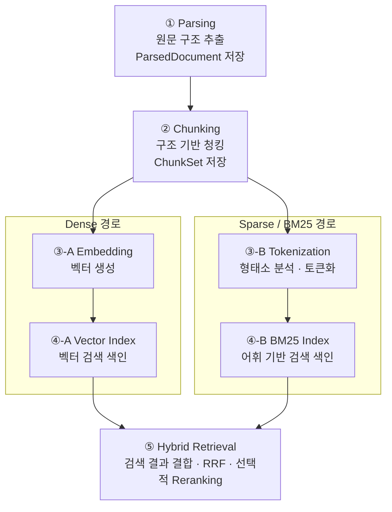

# 문서 처리·하이브리드 검색 파이프라인 (러프 설계)

> 상태: 구조 및 저장 데이터의 1차 설계. 기술 스택·모델·세부 파라미터·구현은 미확정.
>
> 목적: 문서군·기관·데이터셋에 독립적인 로컬 처리 구조를 만들고, 각 단계의 출력을 저장해 재사용·비교·실패 추적 가능하게 한다.
>
> 설계 경계: **파싱 → 청킹 → (Dense 임베딩 / BM25 토큰화) → 각각의 색인 → 하이브리드 검색**. RAG 답변 생성·근거 검증은 후속 단계로 분리한다.

## 1. 파이프라인 구조

**도표의 범위:** ①~④는 **문서 등록 시** 색인을 준비하는 경로다. ⑤는 **사용자 질문이 들어올 때** 해당 색인을 조회하는 실행 단계다. ⑤에는 별도로 질문·문서 범위가 입력되며, 질문 역시 등록 때 사용한 임베딩 모델 및 BM25 분석기와 호환되는 방식으로 처리한다. 실제 질의 분석과 재랭킹은 다음 설계 단계에서 상세화한다.

여기서 'Sparse / BM25'는 **형태소 분석 등 토큰화에 따른 전통적 어휘 검색**을 뜻한다. 학습 기반 sparse 임베딩(SPLADE 등)을 이미 채택했다는 의미는 아니다. BM25는 형태소 분석이 필수인 알고리즘은 아니지만, 한국어에서는 형태소 분석이 유력한 토큰화 후보이므로 독립 단계로 분리한다.

## 2. 입력 (문서 파일)

| 구분 | 입력 | 처리 원칙 |
|---|---|---|
| 기본 문서 파일 | PDF, HWP 및 지원이 검증된 추가 형식(HWPX 등) | 형식별 파서를 교체 가능하게 구성. 실제 지원 범위는 파서 선정 후 확정 |
| 내용 | 본문, 표, 이미지, 차트, 도형, 수식, 레이아웃 | 추출할 수 없는 요소도 원문 위치·미지원/미검증 상태를 가급적 보존 |
| 문서 메타데이터 | 원본 파일 참조, 확인한 형식, 파일 크기, 내용 해시 | 파일명이나 특정 기관·분야 이름을 로직 분기 조건으로 사용하지 않음 |
| 선택적 처리 설정 | 파서·청킹·토큰화·임베딩·색인 설정 | 문서 내용과 독립된 설정 및 버전으로 기록 |

원문은 로컬에서 관리한다. 모델별·색인별 반복 처리를 위해 동일 파일을 임의로 복제하거나 원문 텍스트를 모든 실행 로그에 중복 기록하지 않는다.

**질의 시 추가 입력:** 검색 질문(`query`), 사용자가 허용한 문서/버전 범위, 선택적 검토 기준. 문서 등록 입력과 혼동하지 않는다.

## 3. 출력 및 저장 (저장할 데이터)

| 단계 | 산출물(개념명) | 저장할 필수 데이터 | 선택적·후속 데이터 |
|---|---|---|---|
| ① Parsing | `DocumentManifest`, `ParsedDocument` | `document_id`, 원문 해시·형식·버전, `block_id`, 요소 종류·순서·추출 내용, 원문 위치, 파서·설정 버전, 추출 상태 | TableIR(셀·병합·헤더 추정), 이미지/도형 영역 참조, OCR·VLM 보완 결과·검증 상태 |
| ② Chunking | `ChunkSet` | `chunk_id`, `document_id`, 참조한 `block_id`와 원문 위치, 청크 원문/검색용 표현, 청킹 설정·버전, 입력·출력 해시 | 표의 행 라벨·상위 열 헤더·각주 연결, 색인용/LLM용/검증용 표현 구분 |
| ③-A Embedding | `EmbeddingArtifact` | `chunk_id`, 벡터 데이터 또는 `vector_ref`, 임베딩 모델 ID·정확한 버전, 차원, 입력 텍스트 해시, 전처리·정규화·지시문 설정 | 배치 ID, 연산 장치, 생성 시간 및 자원 사용량 |
| ④-A Vector Index | `VectorIndexManifest` | 색인 버전·저장 위치, 임베딩 집합 해시, 벡터 차원, 거리 함수/인덱스 설정, `chunk_id` 대응 관계 | 인덱스별 성능·메모리 측정 |
| ③-B Tokenization | `LexicalCorpus` | `chunk_id`, 원본 검색 텍스트 참조, 분석·정규화된 토큰 목록, 토큰화 규칙·분석기/사전 버전, 입력 해시 | 품사 정보, 토큰 위치, 숫자·영문·기호 보존 관련 진단 |
| ④-B BM25 Index | `BM25IndexManifest` 및 실제 색인 | 색인 버전·저장 위치, 토큰화된 코퍼스 해시, `chunk_id` 매핑, BM25 구현·파라미터(`k1`, `b` 등), 색인 건수 | 문서별 TF·길이, 토큰별 DF/IDF, 평균 문서 길이 등 통계(엔진이 관리할 수도 있음) |
| ⑤ Hybrid Retrieval | `RetrievalResult` / `EvidenceBundle` | 질의 ID/해시, 검색 대상 문서·색인 버전, 후보 `chunk_id`·원문 참조, Dense/BM25 개별 순위·점수, 융합 순위, 사용한 검색 설정 | 선택적 재랭킹 결과, 영역 확장 참조, 단계별 시간·오류 |

**공통 저장 규칙:**
- 데이터가 큰 원문·이미지·벡터·색인 본체는 별도 로컬 저장소에 보관하고, 하네스 실행 상태에는 **아티팩트 ID/버전/해시/위치 참조**를 기록한다.
- **아티팩트(재사용 가능한 결과)**, **체크포인트(실행 재개 상태)**, **트레이스(실행 관찰 기록)**는 목적이 달라 논리적으로 분리한다.
- `chunk_id`는 양쪽 색인에서 동일한 원본 청크를 가리킨다. 문서·청킹 버전이 달라지면 ID 또는 색인 계보를 통해 혼동을 방지한다.
- 검색 엔진 내부 통계가 충분히 영속화되는 경우 TF/DF를 별도 파일로 중복 저장할 필요는 없다. **재현 가능한 토큰화 설정·코퍼스 스냅샷·색인 버전**을 확보하는 것이 목적이다.
- 내용 기반 캐시는 입력 해시와 관련 모델·분석기·설정·스키마 버전으로 유효성을 판단한다. 문서명이 같다는 이유만으로 재사용하지 않는다.
- 특정 라이브러리나 데이터셋 전용 스키마에 의존하지 않으며, 로컬·상업적 사용 및 오픈소스 재배포 적합성은 선정 시 별도 확인한다.

## 4. 단계별 설명

**① Parsing — 원문 구조 보존.** PDF/HWP에서 텍스트, 표, 원문 위치, 시각적 영역을 추출한다. 추출이 끝났다는 사실과 내용의 의미가 정확하다는 판단을 구분한다. 파서 교체 시에도 동일한 구조 계약을 유지한다. 자세한 경계는 [파싱 설계](parsing-stage.md)를 참조한다.

**② Chunking — 검색 단위 형성.** 단순 길이 분할보다는 문단·표·섹션 관계를 가능한 범위에서 보존한다. 특히 표의 값이 어떤 행 라벨·열 헤더·각주와 연결되는지 참조를 유지한다. 한 청크에서 임베딩용 표현과 BM25용 표현을 별도로 만들 수도 있지만, 그 원본 출처는 동일한 `chunk_id`로 추적한다.

**③-A/④-A Dense — 의미 기반 검색 준비.** 청크의 검색용 텍스트를 로컬 임베딩 모델로 벡터화하고 색인한다. 모델 또는 임베딩 설정만 달라질 경우 파싱·청킹 결과를 재사용할 수 있도록 한다.

**③-B/④-B Sparse — 어휘 기반 검색 준비.** 청크 텍스트를 토큰화하고 BM25 색인을 만든다. 한국어 형태소 분석기 후보를 비교하되 명사만 남기는 규칙이 부정 표현·수치·영문 약어를 삭제하지 않는지 주의한다. 분석기만 바뀌면 Dense 임베딩을 재생성할 필요가 없도록 한다.

**⑤ Hybrid Retrieval — 검색 결과 결합.** 질문을 각 검색 경로에 전달하여 후보를 가져오고, 동일한 `chunk_id`로 중복을 처리한 뒤 RRF 등의 방법으로 순위를 결합한다. 필요한 경우 추가 재랭킹을 거쳐 **원문으로 되돌아갈 수 있는 근거 후보**를 다음 Agent/검증 단계에 전달한다. 최종 주장의 사실성 검증은 여기서 완료되지 않는다.

## 5. 변경 시 재사용·무효화 범위

| 변경 항목 | 다시 처리해야 하는 대표 단계 |
|---|---|
| 파서·원문 내용 변경 | 변경된 파싱 결과 및 해당 결과에 의존하는 청킹·두 검색 경로 |
| 청킹 전략·검색 표현 변경 | 변경된 청크에 대해 두 검색 경로의 토큰·임베딩 및 색인 |
| 형태소 분석기·사전/정규화 규칙 변경 | Tokenization → BM25 Index |
| 임베딩 모델·차원/입력 설정 변경 | Embedding → Vector Index |
| BM25 `k1`/`b`, 검색 색인 설정 변경 | 해당 BM25 색인 또는 질의 설정(엔진 구현에 따라 다름) |
| RRF/후속 재랭킹 설정 변경 | 질의 시 검색 결과의 결합·재랭킹 단계(필요 후보와 기록이 남아 있다면 재사용 가능) |

개별 검색 점수의 척도가 달라 Dense 유사도와 BM25 점수를 그대로 더하지 않는다. **RRF는 원점수 대신 순위를 합치는 기본 후보**이며, 검색 품질이 항상 개선된다는 전제는 두지 않는다. 최종 결정은 별도 평가 결과를 기준으로 한다.

## 6. 다음 설계 단계

**다음 대상: 질의 처리 및 하이브리드 검색(⑤).** 결정할 항목은 (1) 검색 요청·문서 필터 계약, (2) Dense/BM25 각각의 후보 수, (3) 중복 제거·RRF·재랭킹의 책임 경계, (4) `EvidenceBundle` 필수 필드와 원문 확장, (5) retrieval 성능과 답변·근거 검증 지표의 구분이다.

검색은 답변 생성이나 원문의 사실 검증과 독립적으로 평가할 수 있어야 한다. 검색 엔진·임베딩 모델 및 토큰화 구현은 현재 확정하지 않는다.

## 참고

- [하네스 아이디어 백로그](idea-backlog.md)
- [파싱 단계 설계](parsing-stage.md)
- [기술 레퍼런스 목록](reference-catalog.md)
- [Elasticsearch: Reciprocal rank fusion](https://www.elastic.co/docs/reference/elasticsearch/rest-apis/reciprocal-rank-fusion)
- [Qdrant: Hybrid and multi-stage queries](https://qdrant.tech/documentation/search/hybrid-queries/)
