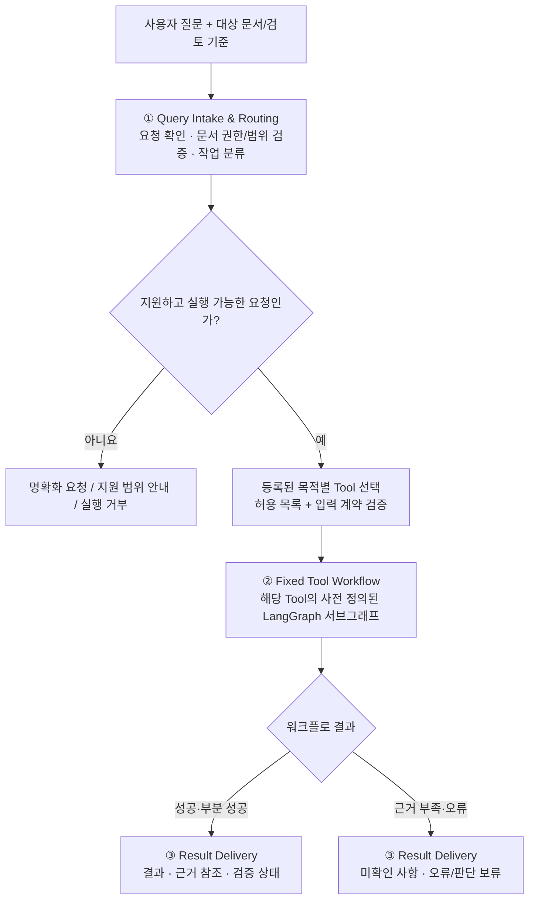
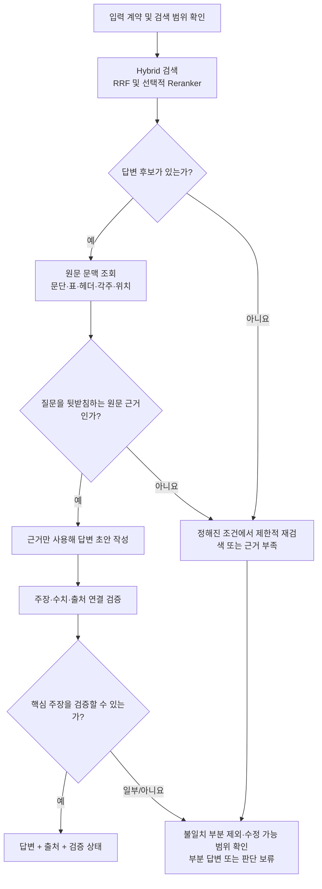
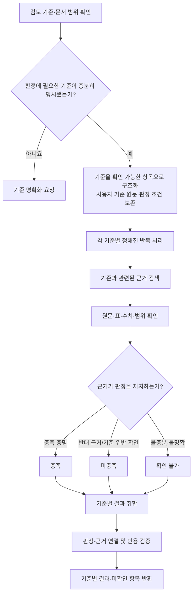
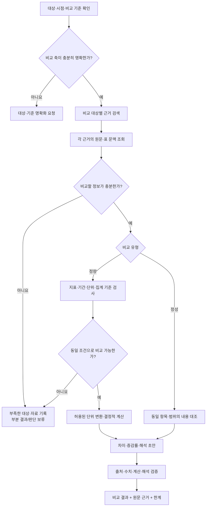

# Query Agent — MVP 3단계 실행 구조

> 상태: **MVP 3단계 실행 구조 확정(2026-10-31)**. **작업 Tool 5종을 계획에 등록하고, 그중 3종의 고정 워크플로를 1차 상세 설계**한다. 최종 구현·구체 파라미터·평가 결과는 아직 미확정이다.
>
> 목적: 사용자 질의에 대응하는 작업을 정해진 Tool로 전달하고, **각 Tool의 목적별 고정 워크플로**를 실행한 후 검증 상태와 원문 근거를 포함한 결과를 반환한다.
>
> 결정 근거: [하네스 아이디어 백로그](idea-backlog.md#0-결정-현황-2026-10-30). DSH의 실행·이벤트·도구 계약을 참고하되, MVP는 DSH식 자율적인 도구 반복 호출을 기본 실행 방식으로 사용하지 않는다.
>
> **최소 단위 노드 설계 LIST:** [MVP 공통·전용 노드 목록(N-01부터 N-09까지)](query-agent-node-list.md). 이 문서는 작업 Tool별 실행 흐름을, 노드 목록은 재사용할 최소 단위와 책임을 관리한다.

## 1. 전체 실행 흐름

**고정 워크플로의 의미:** 전체 단계와 허용 분기·도구 호출 경계는 설계 시 결정한다. 입력에 따라 미리 정의한 조건부 분기, 건너뛰기, 제한된 재시도는 허용하지만, Agent가 실행 도중 도구의 호출 순서나 실행 그래프를 임의로 확장하지 않는다.

**MVP 실행 단위:** 초기 요청 확인 후 **등록된 작업 Tool 하나를 선택하는 구조를 우선**한다. 서로 다른 작업을 자율적으로 연쇄 호출하거나 다중 Agent를 동원하는 것은 기본 경로에서 제외한다. 필요하면 별도 설계·실험으로 확장할 수 있다.

## 2. 세 단계의 책임과 입출력

| 단계 | 책임 | 입력 | 출력 및 저장 |
|---|---|---|---|
| ① Query Intake & Routing | 원본 질의 보존, 입력 형식·대상 문서·권한·검토 조건 확인, 지원 작업 분류, 등록된 Tool 선택. 모호·미지원 요청은 실행 전에 분기 | 원본 질문, 사용자 선택 문서와 버전·범위, 명시적 조건 | `ReviewRequest`, `RoutedTask` 후보(`tool_id`, 분류 결과, 명시/추론 조건의 구별, 대상 문서 참조, 상태) |
| ② Fixed Tool Workflow | Tool별 정해진 처리 단계·도구·조건부 분기를 실행. 필요한 검색·원문 조회·계산·검증 수행; 단계별 상태/오류/예산 기록 | 검증된 `RoutedTask`, 문서·색인/아티팩트 참조, 해당 Tool의 버전·설정 | `WorkflowResult` (상태, 결과, 근거/아티팩트 참조, 미확인 항목, 오류), Checkpoint, 실행 Trace |
| ③ Result Delivery | Tool 결과 계약을 검사하고 사용자가 읽을 수 있는 응답으로 변환. 입증되지 않은 판단은 보류하고 출처·한계 노출 | `WorkflowResult` | `FinalReview` 또는 해당 작업의 사용자 결과, 문서·페이지/블록 위치 및 검증 상태 |

**주의:** 명시적 요청 확인은 무조건 사용자에게 재확인을 요구한다는 의미가 아니다. 입력이 명확하고 유효하면 곧바로 라우팅하고, 모호성·권한 부족·지원되지 않는 요청 등 필요한 경우에만 명확화하거나 거부한다.

## 3. 고정 워크플로 Tool과 기초 기능의 경계

- **작업 Tool(외부로 노출되는 실행 단위):** 사용자의 특정 목적을 해결하기 위한 LangGraph 서브그래프. 예: 근거 조회를 동반한 문서 검토, 문서 간 비교, 수치 검토. **현재 계획상 5개 후보를 관리하고, 3개를 MVP 상세 설계·구현 우선 대상으로 둔다.** 도구 병합·분리는 실험 후 재검토할 수 있다.
- **기초 기능(서브그래프 내부에서 호출하는 모듈):** `retrieve_evidence`, `get_source_context`, `calculate` 및 관련 검증 함수 등. 기존 문서 처리·Dense/BM25 검색·RRF와 선택형 Reranker는 이 계층에서 재사용한다.
- **하네스 공통 책임:** 요청·결과 계약 검증, Tool 등록 및 권한, 체크포인트/아티팩트 참조, 실행 로그, 취소·오류·시간/토큰 예산, 단계별 추적.
- **LLM 역할:** 라우팅이나 워크플로 내부의 제한된 해석·요약 등에 사용 가능하다. **LLM 사용 자체는 자유로운 도구 호출 권한을 의미하지 않는다.** 모델·기술 선택은 미확정.
- **검증 경계:** 근거 관련성, 원문 데이터 정확성, 최종 주장·인용 정합성을 구분한다. 검색 순위나 Reranker 점수가 사실 검증의 대체물이 되지는 않는다.

### Tool 워크플로별 작성할 항목

각 목적별 Tool은 다음 요소를 별도의 설계 단위로 기록하고 결정한다.

| 항목 | 정의할 내용 |
|---|---|
| 목적 / 지원 질문 | 해결하는 사용자 문제와 지원하지 않는 범위 |
| 입력 계약 | `RoutedTask` 내 필수 조건, 허용 문서 및 참조 버전 |
| 고정 실행 단계 | 처리 노드의 순서·의존성·조건부 분기·필요 도구 |
| 근거·검증 | 원문 위치 조회, 표/각주/단위 검증 책임 및 판단 보류 조건 |
| 예외와 실행 예산 | 오류 분류, 제한된 재시도, 타임아웃, 토큰/도구 호출 제한 |
| 결과 계약 | `WorkflowResult`의 업무별 내용과 공통 상태값 |
| 비교 실험 | 품질·근거 정합성·지연·비용 지표와 후속 방식 교체 기준 |

## 4. 목적별 작업 Tool 계획 — 5종

**노드 목록 연계:** 아래 T-01부터 T-03까지의 내부 최소 단위 노드와 사용 관계는 [별도 노드 LIST](query-agent-node-list.md#3-작업-tool별-노드-조합-색인)에서 확인한다. 이 문서는 워크플로 단계·분기 설계에 집중한다.

다음 Tool은 **사용자 요청을 처리하는 작업 단위**다. `retrieve_evidence`, `get_source_context`, `calculate`처럼 워크플로 내부에서 재사용하는 기초 기능과 구별한다.

| ID / 작업 Tool (설계명) | 요청 예시 | 핵심 목표 | 계획 상태 |
|---|---|---|---|
| T-01 **Document QA** | "이 보고서에 제시된 핵심 성과가 뭐야?" | 특정 질문에 맞는 답변과 직접적인 원문 근거 반환 | **MVP 우선 / 워크플로 상세 설계** |
| T-02 **Criteria Review** | "이 계획서가 명시한 평가 조건을 충족했는지 확인해 줘." | 사용자 지정 기준별 충족·미충족·확인 불가 판정 | **MVP 우선 / 워크플로 상세 설계** |
| T-03 **Comparative Analysis** | "2024년과 2025년 실적을 비교해 줘." | 동일한 비교 기준에서 문서·기간·값의 차이를 분석 | **MVP 우선 / 워크플로 상세 설계** |
| T-04 **Claim Verification** | "이 보고서의 비용 절감 주장을 근거로 검증해 줘." | 주장별 근거·반증 검토와 검증 가능 범위 표시 | 계획 유지 / 상세 설계 보류 |
| T-05 **Document Summary** | "보고서 전체를 핵심 중심으로 요약해 줘." | 문서 전체를 구조적으로 다루는 출처 기반 요약 | 계획 유지 / 상세 설계 보류 |

**범위 결정:** T-01, T-02, T-03을 **구현 준비를 위한 1차 설계 우선 대상**으로 한다. T-04, T-05는 계획에서 삭제하지 않고, 현재 단계에서는 독립 Tool 구현을 확정하지 않는다. 모든 항목은 문서·기관·평가셋에 종속되지 않는 범용 경계로 정의한다.

### 4.1 세 Tool에 공통으로 적용할 원칙

- **사전 정의된 순서:** 요청 확인(1단계)은 선택된 Tool에 검증된 `RoutedTask`를 넘긴다. Tool 내부의 실행 노드와 분기는 미리 정의한다. LLM에 무제한 도구 호출이나 실행 계획 생성 권한을 부여하지 않는다.
- **근거 확보:** 질문 또는 사용자가 명시한 검토 기준과 허용된 문서 범위로 기존 `retrieve_evidence`를 호출한다. 검색은 [문서 처리 파이프라인](document-pipeline.md)의 Dense + BM25 + RRF 및 실험 대상 Reranker 구성을 재사용한다. 초기 검색 실패 자체를 반증으로 해석하지 않는다.
- **원문 대조:** 검색 후보는 `get_source_context` 등을 통해 문단·표·헤더·행 라벨·각주·페이지 위치를 확인한다. 후보 순위와 원문 추출의 검증 상태, 최종 결론의 신뢰 상태를 구별한다.
- **제한된 재시도:** 미리 정한 조건(후보 없음, 필요한 근거 누락, 인용 불일치 등)에만 동일 단계의 제한적 재시도를 허용한다. 최대 횟수·후보 수·시간·토큰 예산은 추후 확정한다. 원본 쿼리 증폭(PRF/Multi-query/HyDE)은 도입하지 않는다.
- **일관된 출력:** 업무별 내용은 달라도 `WorkflowResult`를 통해 상태, 결과, 근거 참조, 검증 결과, 미확인 항목, 오류, 실행 아티팩트 참조를 반환한다. 3단계의 Result Delivery는 이 결과를 사용자에게 전달한다.
- **근거 없는 생성 금지:** 근거 부족을 그럴듯한 답변으로 보완하지 않는다. `success`, `partial`, `needs_clarification`, `insufficient_evidence`, `unsupported`, `error` 같은 상태를 구별하는 방안을 검토한다. 실제 상태명·스키마는 미확정이다.

### 4.2 T-01 Document QA — 문서 정보·근거 질의응답

**목적:** 질문에 해당하는 보고서의 내용을 찾고, 그 내용으로 뒷받침되는 짧고 명료한 답변을 만든다. 단순한 관련 청크 반환이나 문서 전체 요약과는 구별한다.

**입력:** `RoutedTask`의 원본 질문, 허용된 문서 ID/버전, 대상 절·기간 등의 명시적 제약. 질문에 답하는 데 필수적인 대상이 빠졌다면 실행 전에 `needs_clarification`으로 종료한다.

**고정 워크플로(초안)**

| 단계 | 구체적 수행 및 확인 사항 | 보존할 결과(개념) |
|---|---|---|
| Q1. 질문·범위 확인 | 대상 문서/버전, 질문의 대상·시점·제약 확인. 임의의 조건 추가 금지 | `QARequest` 또는 `RoutedTask` 참조 |
| Q2. 검색 | 동일 쿼리로 하이브리드 검색. 최종 검색 전략은 실험 결과에 따라 선택 | `RetrievalCandidates`, `EvidenceBundle` |
| Q3. 원문 조회·적합성 확인 | 관련성뿐 아니라 질문에 직접 답하는지, 표의 헤더·단위·각주가 맞는지 확인 | 근거 항목별 `source_ref`, 추출·검증 상태 |
| Q4. 답변 초안 | 확인된 정보만 사용하고 정보가 없는 부분은 미확인으로 유지 | `ReviewDraft`, 주장별 근거 참조 |
| Q5. 인용 검증·결과 | 주장마다 근거를 대조. 오류가 있으면 해당 주장 제외 또는 허용된 보정 후 재검사 | `VerificationReport`, QA형 `WorkflowResult` |

**분기·판단 보류:** 검색된 내용이 질문과 관련 있어도 직접적인 답이 아닐 수 있다. 후보가 없거나 수치·시점·원문 위치가 불확실하면 정해진 범위에서만 재조회하고, 여전히 부족하면 `insufficient_evidence`를 반환한다. 일부 주장만 근거가 있으면 그 부분만 설명하고 나머지를 미확인으로 표시한다.

**결과 예시(형태):** 답변 본문, 뒷받침된 주장 목록, 주장별 출처 위치/문서 버전, 생략·미확인 내용, 실행·검증 상태. 문서 전체를 요약하지 않는다.

**평가 후보:** 답변 가능 여부 판단, 주장별 출처 지지율, 사실·숫자 오류율, 근거 부족 시 보류율, 검색 및 전체 실행 지연.

### 4.3 T-02 Criteria Review — 명시적 기준 충족 검토

**목적:** 사용자가 제공한 검토 기준을 항목별로 확인해 **충족 / 미충족 / 확인 불가**를 각각 판정한다. 단순 정보 조회와 달리 기준의 조건·임계값·확인 범위가 판정의 핵심이다.

**입력:** 원본 질문, **사용자 또는 입력 서식이 명시한 검토 기준**, 문서 범위·버전, 필요한 평가 시점과 대상. 기준이 제공되지 않거나 필수 조건의 의미가 불명확하면 임의의 평가 기준을 생성하지 않고 명확화를 요청한다.

**고정 워크플로(초안)**

| 단계 | 구체적 수행 및 확인 사항 | 보존할 결과(개념) |
|---|---|---|
| C1. 기준 검증·구조화 | 사용자 기준을 누락·변경 없이 조건별 항목으로 구성. 수치 임계값, 시점, 범위, 예외 조건을 구별 | `CriteriaSet`(항목 ID·원문·판정 조건) |
| C2. 기준별 검색 | 각 명시적 항목의 원문 조건을 검색 입력으로 활용. 기준별 서로 다른 근거 참조 허용 | 기준별 `EvidenceBundle` 참조 |
| C3. 원문 대조 | 조건을 지지·반박하는 자료와 추출 오류·단위 차이를 확인 | 기준별 지지·반박 근거 및 검증 상태 |
| C4. 항목 판정 | 조건 충족은 직접 근거 필요. 미충족은 위반을 입증하는 자료 또는 범위가 확인된 완전성 검사 필요 | `CriterionFinding`(상태·판정 이유·근거) |
| C5. 검증·집계 | 판정과 인용 정합성 확인. 전체 통과 여부는 사용자가 지정한 집계 규칙이 있을 때만 산출 | `VerificationReport`, Criteria형 `WorkflowResult` |

**특별 규칙:** **검색 결과에 안 나온다는 이유만으로 '미충족' 판정하지 않는다.** 예를 들어 "문서에 목표 수치가 없다"는 부재 주장은 대상 전체를 확인할 수 있는 방법과 검사 범위가 확보된 경우에만 인정한다. 단순 Top-k 검색으로 찾지 못했다면 `확인 불가`다.

**질의 증폭과의 경계:** 사용자가 제시한 평가 조건을 **검증 항목으로 분리**하는 것은 업무 판정 절차다. 새로운 의미의 질문을 여러 개 생성해 검색하는 Multi-query/PRF/HyDE와 구별하며, 기존 H-12 백로그의 도입 결정을 변경하지 않는다.

**결과 예시(형태):** 평가 기준 ID/원문, 각 항목의 충족·미충족·확인 불가, 근거 및 반증 위치, 미확인 이유, 사용자 정의 집계 조건에 따른 결과(있는 경우).

**평가 후보:** 기준별 판정 정확도, 충족·미충족·보류의 혼동, 근거 지지율, 누락·부재를 과도하게 확정하는 비율, 조건 수에 따른 실행 지연.

### 4.4 T-03 Comparative Analysis — 문서·기간·지표 비교

**목적:** 사용자 지정 두 대상 이상을 **동일한 비교 기준**에서 정성적 또는 정량적으로 비교한다. 수치 계산은 검증된 값을 대상으로 결정적으로 실행하고, 인과관계나 개선·악화의 판단에는 별도 근거 또는 사용자 기준이 필요하다.

**입력:** 비교 대상(문서/기간/절/항목), 허용 문서·버전, 비교 지표 또는 질문, 사용자가 명시한 평가 기준. 비교 대상이나 지표가 불명확하면 임의로 정하지 않는다.

**고정 워크플로(초안)**

| 단계 | 구체적 수행 및 확인 사항 | 보존할 결과(개념) |
|---|---|---|
| A1. 비교 축 확인 | 주체·문서 버전·기간·지표·계산 기준·분석 범위를 식별 | `ComparisonSpec`(대상 및 비교 축) |
| A2. 근거 확보 | 각 대상에 대해 같은 기준으로 근거 검색, 표·문단·출처 조회 | 대상별 `EvidenceBundle`, `source_ref` |
| A3. 비교 가능성 검증 | 숫자일 경우 단위·기준 기간·집계 범위·동일 지표 여부 확인. 텍스트일 경우 동일 항목의 의미·범위 확인 | 비교 가능/불가능 사유와 원문 값 |
| A4. 계산·비교 | 검증된 값에 대해서만 차이·증감률 등을 결정적으로 계산. 정성 비교는 각 대상의 명시적 내용에서 공통점·차이점 추출 | `CalculationResult` 또는 정성 비교 항목 |
| A5. 해석·검증 | 수치·계산·인용 재확인. 개선·악화의 기준 및 인과 설명은 명시된 근거가 있는지 별도 확인 | `ComparisonFinding`, `VerificationReport`, Comparison형 `WorkflowResult` |

**비교 불가능 상태:** 한쪽의 자료가 없거나 기간·단위·집계 기준이 다르고 검증된 환산 방법도 없다면 억지로 비교하지 않는다. 가능한 항목만 부분 반환하거나 비교 불가 이유를 함께 전달한다.

**수치 해석 제한:** 0을 기준값으로 사용하는 증감률 등 정의되지 않는 연산은 계산 오류가 아니라 **비교 조건상 계산 불가**로 표시한다. 단위 변경은 명시적이고 검증 가능한 경우에만 허용하고, 서로 다른 통화·물가 기준 등의 외부 변환 기준은 임의로 생성하지 않는다.

**원인 질문 처리:** "왜 증가했는가?"는 값의 증가 자체로부터 인과관계를 추론하지 않는다. 문서에 원인 설명이 직접 제시되면 이를 출처와 함께 서술하고, 그렇지 않으면 **증감은 확인됐지만 원인은 미확인**으로 구분한다.

**결과 예시(형태):** 비교 축, 대상별 원문 값·위치, 정량 계산 또는 정성 항목별 차이, 비교 가능성, 확인된 설명과 미확인 사항, 검증 상태.

**평가 후보:** 대상/기간 추출 정확도, 원문 수치 일치율, 단위·집계 불일치 검출, 계산 정확도, 인과 과잉추론 빈도, 부분 결과 판단 적절성.

### 4.5 추후 계획: T-04 Claim Verification / T-05 Document Summary

| Tool | 설계할 때 확인할 핵심 | 현재 경계 |
|---|---|---|
| **T-04 Claim Verification** | 주장 단위 분해, 지지·반박 근거의 충분성, 주장별 정합성, 출처의 독립성. Criteria Review 내부의 판정·검증 기능과 중복되는지 평가 | **상세 워크플로 보류.** 보유한 문서의 진술과 일치하는지 검증하는 것과 외부 세계의 사실 자체를 증명하는 것은 구별해야 함 |
| **T-05 Document Summary** | 문서 전체 범위 확인, 제목·절·표의 요약 비중, 누락·왜곡 검증, 요약 문장별 출처 연결. Document QA와 기능 중복 평가 | **상세 워크플로 보류.** 검색 Top-k만 요약해 문서 전체 요약이라고 주장하는 방식은 피함 |

두 Tool 모두 **5종 계획에 포함**하지만, 현재 3종 상세 설계가 안정화되기 전까지는 고정 노드·스키마·구현 방식·일정을 확정하지 않는다.

### 4.6 공통 내부 기능·설계 기록

**최소 단위 노드 식별자(N-01부터 N-09까지)는 [공통·전용 노드 LIST](query-agent-node-list.md)에 별도로 정리했다.** 아래 표는 역할별 재사용 범위만 요약하며, 독립 LangGraph 노드 수를 확정하는 것은 아니다.

| 재사용할 기초 기능(개념명) | T-01 QA | T-02 Criteria | T-03 Comparison | 책임 |
|---|---|---|---|---|
| `retrieve_evidence` | 사용 | 사용 | 사용 | 허용 범위의 하이브리드 검색 및 후보 반환 |
| `get_source_context` | 사용 | 사용 | 사용 | 원문 문단·표·각주·위치와 추출 상태 확인 |
| 구조화된 값·조건 추출 | 필요 시 | 필요 시 | 정량 비교에서 필요 | 내용과 수치/기간/단위 참조를 추출하되 검증 전 확정하지 않음 |
| `calculate` | 필요 시 | 임계값 검토 시 | 정량 비교 시 | 결정적 산술·단위 조건 확인 |
| 인용·주장 검증 | 사용 | 사용 | 사용 | 주장별 근거 지지 여부, 모순·미확인 식별 |
| 결과 형식화 | 사용 | 사용 | 사용 | 공통 `WorkflowResult`를 읽기 쉬운 결과로 전달 |

**저장 원칙:** 요청과 라우팅 정보 → 검색 결과·원문 참조 → 정량 계산/항목별 판정 → 초안/검증 보고서 → 최종 결과의 관계를 아티팩트 ID로 연결한다. 원문을 매 실행의 체크포인트·트레이스에 중복 복사하지 않는다. 사용한 워크플로 버전, 문서·색인 버전, 도구/모델 구성, 실행 상태, 실패 이유를 추적 가능하게 유지한다.

**설계 검증 관점:** 3종 Tool 각각에 대해 정상적인 답변, 검색 실패, 원문 출처 불일치, 부분 근거만 있는 경우, 권한·범위 오류, 계산 불가능 등의 사례를 마련한다. 사용자 의도 분류 정확도(1단계)와 Tool 내부 근거 검증 정확도(2단계), 결과 표현 정확도(3단계)를 분리해 평가한다.

**미정 사항:** 라우팅 방식, 각 Tool의 필수·선택 필드와 구체 자료형, 재검색 최대 횟수, 후보 Top-k, 모델과 프롬프트, 완료·보류 판단 기준의 수치화, LangGraph 세부 구현 및 테스트 결과.

## 5. 기존 설계와의 관계

- [문서 처리·검색 파이프라인](document-pipeline.md)은 **작업 Tool 내부의 검색 능력** 또는 사전 문서 등록 단계로 유지한다. RRF 단독 / Reranker 추가 구성은 실험 후 결정한다.
- **쿼리 증폭·재작성은 H-12 백로그**에 유지하고 MVP 기본 라우팅 및 검색 경로에 포함하지 않는다.
- [DSH 분석 참고](../references/deepseek-harness/README.md)는 Agent 실행 이벤트, Tool 호출 전후 정책, Session 기록의 참고 자료다. 자유 실행 루프를 그대로 도입하지 않는다.
- **MVP 이후 변경 가능:** 더 높은 자율성이 실제 평가에서 이점을 보일 경우 Tool 조합, 재계획, 제한적 Agent Loop를 별도 실행 전략으로 실험한다. 현재 결정된 3단계 계약을 기본 비교 대상으로 보존한다.

## 6. 아직 결정하지 않은 것

**5종 작업 Tool 계획과 3종의 1차 고정 워크플로 설계까지 완료했다.** 아직 미정인 것은 실제 MVP 배포 도구 범위, 라우팅 구현, LangGraph의 세부 노드/엣지 및 조건식, 입출력 스키마의 자료형, 검색·재시도 예산, 저장 기술, 평가셋·지표의 통과 기준이다. 이 문서의 단계·분기는 **설계 초안**이며 코드 작성·테스트 실행·성능 검증을 완료했다는 의미가 아니다.
