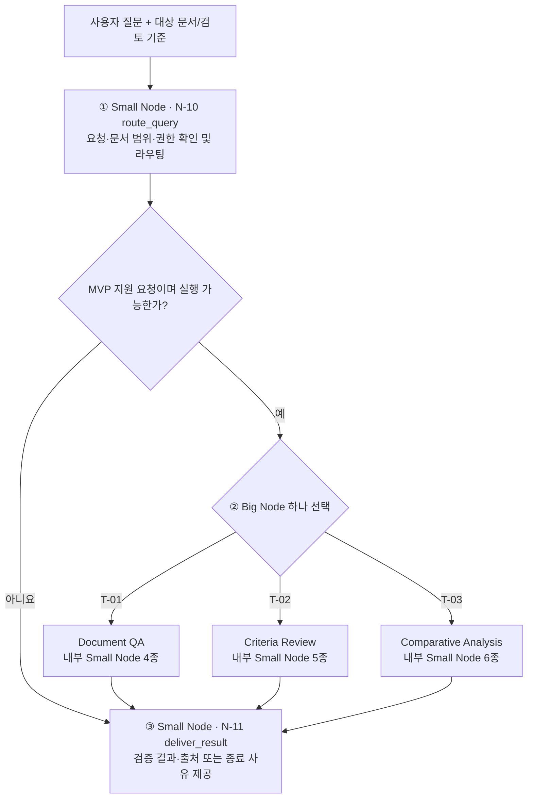

# Query Agent — MVP 3단계 실행 구조

> 상태: **MVP 최상위 Small → Big → Small 구조 확정(2026-10-31)**. Big Node 5종 중 T-01~T-03을 MVP 우선 대상으로 두고, Small Node N-01~N-11을 등록한다. 세부 구현·실행 예산·평가 결과는 미확정이다.
>
> 목적: **N-10 `route_query`(Small Node) → 선택된 T-01/T-02/T-03(Big Node) → N-11 `deliver_result`(Small Node)** 순서로 요청을 처리한다. Big Node 내부는 업무별 Small Node의 사전 정의된 고정 워크플로로 실행한다.
>
> 결정 근거: [하네스 아이디어 백로그](idea-backlog.md#0-결정-현황-2026-10-30). DSH의 실행·이벤트·도구 계약을 참고하되, MVP는 DSH식 자율적인 도구 반복 호출을 기본 실행 방식으로 사용하지 않는다.
>
> **명칭 통일:** [Big Node(T-xx) / Small Node(N-xx) 이름 기준](naming-conventions.md). 기존 문서의 '작업 Tool'은 Big Node, '최소 단위 노드'는 Small Node와 같은 뜻이다.
>
> **Small Node 설계 LIST:** [최상위 공통 N-10·N-11 및 Big Node 내부 N-01~N-09, 총 11종](query-agent-node-list.md). [Big Node 폴더](big-nodes/README.md)는 업무별 워크플로를, 이 문서는 최상위 실행 구조를, 별도 LIST는 전체 Small Node의 식별자·책임을 관리한다.

## 1. 전체 실행 흐름

**고정 워크플로의 의미:** 전체 단계와 허용 분기·도구 호출 경계는 설계 시 결정한다. 입력에 따라 미리 정의한 조건부 분기, 건너뛰기, 제한된 재시도는 허용하지만, Agent가 실행 도중 도구의 호출 순서나 실행 그래프를 임의로 확장하지 않는다.

**MVP 고정 실행 단위:** **N-10 → Big Node 1개 → N-11** 순서를 확정한다. T-04·T-05는 계획만 유지하며 MVP 라우팅 대상에서 제외한다. 입력 불충분·권한·지원 범위 문제로 Big Node 실행이 불가능하면 **N-10 → N-11**로 종료 사유를 전달한다. Big Node 연쇄 호출·자율 재계획·다중 Agent는 기본 경로에서 제외한다.

## 2. 세 단계의 책임과 입출력

| 단계 | 책임 | 입력 | 출력 및 저장 |
|---|---|---|---|
| **① Small Node N-10 `route_query`** | 원본 질문·문서 ID/버전·허용 범위·권한·필수 조건 검증 후 **T-01/T-02/T-03 중 하나로 라우팅**. 불충분·미지원이면 실행 전 종료 | 원본 질문, 선택 문서와 버전·범위, 명시적 조건 | `ReviewRequest`, 실행 가능 시 `RoutedTask`; 불가 시 명확화/거부/미지원 상태·사유 |
| **② Big Node T-01/T-02/T-03** | 업무별 **고정 Small Node 워크플로**로 검색·검토·비교 및 검증 수행. 분기·재시도는 사전 정의 | 유효한 `RoutedTask`, 문서·색인/아티팩트 참조, Big Node별 설정 | `WorkflowResult`, 근거/아티팩트 참조, 체크포인트·실행 Trace |
| **③ Small Node N-11 `deliver_result`** | Big Node의 검증 결과 또는 N-10의 실행 전 종료 사유를 **추가 판단 없이** 전달 | `WorkflowResult` 또는 라우팅 종료 상태·사유 | 사용자 결과(예: `FinalReview`), 근거 출처·검증 상태·미확인 항목·오류 |

**주의:** N-10은 기준별 판정·근거 검색을 수행하지 않으며, N-11은 새로운 결론이나 미검증 근거를 생성하지 않는다. 입력이 명확하고 유효하면 사용자에게 재확인을 요구하지 않고 곧바로 Big Node를 실행한다.

## 3. Big Node·Small Node와 내부 기능의 경계

- **Big Node(목적별 고정 워크플로, T-xx):** 사용자 목적 하나를 해결하는 하위 실행 그래프. **T-01/T-02/T-03 세 개만 MVP 라우팅 대상으로 확정**하고, T-04/T-05는 계획만 유지한다. Big Node를 자율적으로 연쇄 호출하지 않는다.
- **Small Node(N-xx):** Big Node 내부 공통·전용 단위 **N-01~N-09**, 상위 입구·출구 단위 **N-10·N-11**. 세부 검색(Dense/BM25/RRF/선택형 Reranker), 원문 문맥 보조, 결정적 계산은 필요한 Small Node의 **내부 기능**이다.
- **하네스 공통 책임:** 요청·결과 계약 검증, Tool 등록 및 권한, 체크포인트/아티팩트 참조, 실행 로그, 취소·오류·시간/토큰 예산, 단계별 추적.
- **LLM 역할:** 라우팅이나 워크플로 내부의 제한된 해석·요약 등에 사용 가능하다. **LLM 사용 자체는 자유로운 도구 호출 권한을 의미하지 않는다.** 모델·기술 선택은 미확정.
- **검증 경계:** 근거 관련성, 원문 데이터 정확성, 최종 주장·인용 정합성을 구분한다. 검색 순위나 Reranker 점수가 사실 검증의 대체물이 되지는 않는다.

### Big Node 워크플로별 작성할 항목

각 목적별 Tool은 다음 요소를 별도의 설계 단위로 기록하고 결정한다.

| 항목 | 정의할 내용 |
|---|---|
| 목적 / 지원 질문 | 해결하는 사용자 문제와 지원하지 않는 범위 |
| 입력 계약 | `RoutedTask` 내 필수 조건, 허용 문서 및 참조 버전 |
| 고정 실행 단계 | 처리 노드의 순서·의존성·조건부 분기·필요 도구 |
| 근거·검증 | 원문 위치 조회, 표/각주/단위 검증 책임 및 판단 보류 조건 |
| 예외와 실행 예산 | 오류 분류, 제한된 재시도, 타임아웃, 토큰/도구 호출 제한 |
| 결과 계약 | `WorkflowResult`의 업무별 내용과 공통 상태값 |
| 비교 실험 | 품질·근거 정합성·지연·비용 지표와 후속 방식 교체 기준 |

## 4. 목적별 Big Node 계획 — 5종

**Small Node 목록 연계:** [전체 11종 Small Node LIST](query-agent-node-list.md)에서 T-01~T-03 내부의 N-01~N-09 조합과, 모든 요청의 공통 입구 N-10·출구 N-11을 확인한다. 이 문서는 Big Node의 업무별 워크플로 단계·분기에 집중한다.

다음 Tool은 **사용자 요청을 처리하는 작업 단위**다. `retrieve_evidence`, `get_source_context`, `calculate`처럼 워크플로 내부에서 재사용하는 기초 기능과 구별한다.

| ID / Big Node (설계명) | 요청 예시 | 핵심 목표 | 계획 상태 |
|---|---|---|---|
| T-01 **Document QA** | "이 보고서에 제시된 핵심 성과가 뭐야?" | 특정 질문에 맞는 답변과 직접적인 원문 근거 반환 | **MVP 우선 / 워크플로 상세 설계** |
| T-02 **Criteria Review** | "이 계획서가 명시한 평가 조건을 충족했는지 확인해 줘." | 사용자 지정 기준별 충족·미충족·확인 불가 판정 | **MVP 우선 / 워크플로 상세 설계** |
| T-03 **Comparative Analysis** | "2024년과 2025년 실적을 비교해 줘." | 동일한 비교 기준에서 문서·기간·값의 차이를 분석 | **MVP 우선 / 워크플로 상세 설계** |
| T-04 **Claim Verification** | "이 보고서의 비용 절감 주장을 근거로 검증해 줘." | 주장별 근거·반증 검토와 검증 가능 범위 표시 | 계획 유지 / 상세 설계 보류 |
| T-05 **Document Summary** | "보고서 전체를 핵심 중심으로 요약해 줘." | 문서 전체를 구조적으로 다루는 출처 기반 요약 | 계획 유지 / 상세 설계 보류 |

**범위 결정:** T-01, T-02, T-03을 **구현 준비를 위한 1차 설계 우선 대상**으로 한다. T-04, T-05는 계획에서 삭제하지 않고, 현재 단계에서는 독립 Tool 구현을 확정하지 않는다. 모든 항목은 문서·기관·평가셋에 종속되지 않는 범용 경계로 정의한다.

### 4.1 세 Tool에 공통으로 적용할 원칙

- **사전 정의된 순서:** 요청 확인(1단계)은 선택된 Tool에 검증된 `RoutedTask`를 넘긴다. Tool 내부의 실행 노드와 분기는 미리 정의한다. LLM에 무제한 도구 호출이나 실행 계획 생성 권한을 부여하지 않는다.
- **근거 확보:** 질문 또는 사용자가 명시한 검토 기준과 허용된 문서 범위로 기존 `retrieve_evidence`를 호출한다. 검색은 [문서 처리 파이프라인](document-pipeline.md)의 Dense + BM25 + RRF 및 실험 대상 Reranker 구성을 재사용한다. 초기 검색 실패 자체를 반증으로 해석하지 않는다.
- **원문 대조:** 검색 후보는 `get_source_context` 등을 통해 문단·표·헤더·행 라벨·각주·페이지 위치를 확인한다. 후보 순위와 원문 추출의 검증 상태, 최종 결론의 신뢰 상태를 구별한다.
- **제한된 재시도:** 미리 정한 조건(후보 없음, 필요한 근거 누락, 인용 불일치 등)에만 동일 단계의 제한적 재시도를 허용한다. 최대 횟수·후보 수·시간·토큰 예산은 추후 확정한다. 원본 쿼리 증폭(PRF/Multi-query/HyDE)은 도입하지 않는다.
- **일관된 출력:** 업무별 내용은 달라도 `WorkflowResult`를 통해 상태, 결과, 근거 참조, 검증 결과, 미확인 항목, 오류, 실행 아티팩트 참조를 반환한다. 3단계의 Result Delivery는 이 결과를 사용자에게 전달한다.
- **근거 없는 생성 금지:** 근거 부족을 그럴듯한 답변으로 보완하지 않는다. `success`, `partial`, `needs_clarification`, `insufficient_evidence`, `unsupported`, `error` 같은 상태를 구별하는 방안을 검토한다. 실제 상태명·스키마는 미확정이다.

### 4.2 목적별 Big Node 상세 문서

**업무별 Small Node의 사용 순서·조건부 엣지·보류 정책은 아래 문서에서만 상세 관리한다.** 현재 문서는 최상위 Small → Big → Small 구조의 정본으로 둔다.

| 문서 | 상태 | 내부 Small Node 기본 순서 |
|---|---|---|
| [T-01 Document QA](big-nodes/T-01.md) | MVP · 1차 설계 | N-01 → N-02 → N-04 → N-03 |
| [T-02 Criteria Review](big-nodes/T-02.md) | MVP · 1차 설계 | N-05 → (기준별 N-01 → N-02 → N-06) → N-03 |
| [T-03 Comparative Analysis](big-nodes/T-03.md) | MVP · 1차 설계 | N-07 → (대상별 N-01 → N-02) → N-08 → N-09 → N-03 |
| [T-04 Claim Verification](big-nodes/T-04.md) | 후속 계획 | 미정 |
| [T-05 Document Summary](big-nodes/T-05.md) | 후속 계획 | 미정 |

[Big Node 목록](big-nodes/README.md) · [Small Node 목록](small-nodes/README.md)

### 4.3 공통 하네스·검증 기록

**저장 원칙:** 라우팅 → 검색·원문 → 판정/비교/초안 → 검증 → 결과를 아티팩트 ID로 연결한다. 원문을 매 실행 로그·체크포인트에 중복 복사하지 않는다. 문서·색인·모델·워크플로 버전과 오류 사유를 추적 가능하게 유지한다.

**검증 사례:** 정상 답변, 검색 실패·원문 출처 불일치·부분 근거·권한 오류·계산 불가 등을 Big Node별로 평가한다.

**미정:** 최대 재검색, Top-k, 각 단계 실제 데이터 타입·분기·LLM 구성과 실행 검증 결과.

## 5. 기존 설계와의 관계

- [문서 처리·검색 파이프라인](document-pipeline.md)은 **작업 Tool 내부의 검색 능력** 또는 사전 문서 등록 단계로 유지한다. RRF 단독 / Reranker 추가 구성은 실험 후 결정한다.
- **쿼리 증폭·재작성은 H-12 백로그**에 유지하고 MVP 기본 라우팅 및 검색 경로에 포함하지 않는다.
- [DSH 분석 참고](../references/deepseek-harness/README.md)는 Agent 실행 이벤트, Tool 호출 전후 정책, Session 기록의 참고 자료다. 자유 실행 루프를 그대로 도입하지 않는다.
- **MVP 이후 변경 가능:** 더 높은 자율성이 실제 평가에서 이점을 보일 경우 Tool 조합, 재계획, 제한적 Agent Loop를 별도 실행 전략으로 실험한다. 현재 결정된 3단계 계약을 기본 비교 대상으로 보존한다.

## 6. 아직 결정하지 않은 것

**Small → Big → Small의 최상위 실행 구조, Big Node 3종의 MVP 라우팅 대상, Small Node 11종의 목록을 확정했다.** T-04/T-05는 후속 후보이고 T-01/T-02/T-03의 내부 상세 흐름은 1차 설계 상태다. 아직 미정인 것은 실제 MVP 배포 도구 범위, 라우팅 구현, LangGraph의 세부 노드/엣지 및 조건식, 입출력 스키마의 자료형, 검색·재시도 예산, 저장 기술, 평가셋·지표의 통과 기준이다. 이 문서의 단계·분기는 **설계 초안**이며 코드 작성·테스트 실행·성능 검증을 완료했다는 의미가 아니다.
