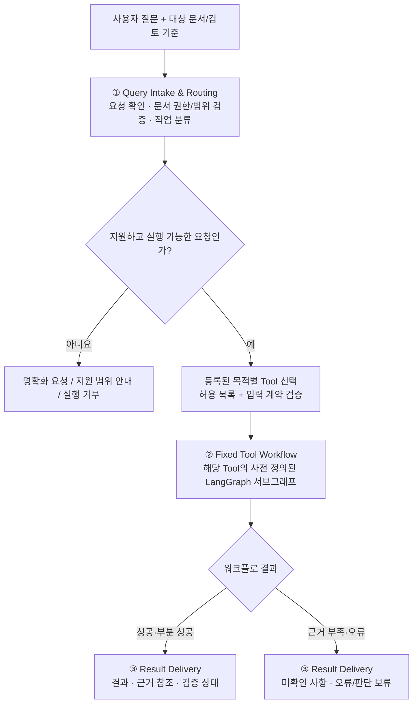

# Query Agent — MVP 3단계 실행 구조

> 상태: **MVP 실행 구조 확정(2026-10-31)**. 도구 종류, 각 도구의 내부 단계, 조건부 분기·실행 예산·세부 데이터 스키마는 추후 설계 및 실험으로 확정한다.
>
> 목적: 사용자 질의에 대응하는 작업을 정해진 Tool로 전달하고, **각 Tool의 목적별 고정 워크플로**를 실행한 후 검증 상태와 원문 근거를 포함한 결과를 반환한다.
>
> 결정 근거: [하네스 아이디어 백로그](idea-backlog.md#0-결정-현황-2026-10-30). DSH의 실행·이벤트·도구 계약을 참고하되, MVP는 DSH식 자율적인 도구 반복 호출을 기본 실행 방식으로 사용하지 않는다.

## 1. 전체 실행 흐름

**고정 워크플로의 의미:** 전체 단계와 허용 분기·도구 호출 경계는 설계 시 결정한다. 입력에 따라 미리 정의한 조건부 분기, 건너뛰기, 제한된 재시도는 허용하지만, Agent가 실행 도중 도구의 호출 순서나 실행 그래프를 임의로 확장하지 않는다.

**MVP 실행 단위:** 초기 요청 확인 후 **등록된 작업 Tool 하나를 선택하는 구조를 우선**한다. 서로 다른 작업을 자율적으로 연쇄 호출하거나 다중 Agent를 동원하는 것은 기본 경로에서 제외한다. 필요하면 별도 설계·실험으로 확장할 수 있다.

## 2. 세 단계의 책임과 입출력

| 단계 | 책임 | 입력 | 출력 및 저장 |
|---|---|---|---|
| ① Query Intake & Routing | 원본 질의 보존, 입력 형식·대상 문서·권한·검토 조건 확인, 지원 작업 분류, 등록된 Tool 선택. 모호·미지원 요청은 실행 전에 분기 | 원본 질문, 사용자 선택 문서와 버전·범위, 명시적 조건 | `ReviewRequest`, `RoutedTask` 후보(`tool_id`, 분류 결과, 명시/추론 조건의 구별, 대상 문서 참조, 상태) |
| ② Fixed Tool Workflow | Tool별 정해진 처리 단계·도구·조건부 분기를 실행. 필요한 검색·원문 조회·계산·검증 수행; 단계별 상태/오류/예산 기록 | 검증된 `RoutedTask`, 문서·색인/아티팩트 참조, 해당 Tool의 버전·설정 | `WorkflowResult` (상태, 결과, 근거/아티팩트 참조, 미확인 항목, 오류), Checkpoint, 실행 Trace |
| ③ Result Delivery | Tool 결과 계약을 검사하고 사용자가 읽을 수 있는 응답으로 변환. 입증되지 않은 판단은 보류하고 출처·한계 노출 | `WorkflowResult` | `FinalReview` 또는 해당 작업의 사용자 결과, 문서·페이지/블록 위치 및 검증 상태 |

**주의:** 명시적 요청 확인은 무조건 사용자에게 재확인을 요구한다는 의미가 아니다. 입력이 명확하고 유효하면 곧바로 라우팅하고, 모호성·권한 부족·지원되지 않는 요청 등 필요한 경우에만 명확화하거나 거부한다.

## 3. 고정 워크플로 Tool과 기초 기능의 경계

- **작업 Tool(외부로 노출되는 실행 단위):** 사용자의 특정 목적을 해결하기 위한 LangGraph 서브그래프. 예: 근거 조회를 동반한 문서 검토, 문서 간 비교, 수치 검토. **이름·개수·MVP 포함 여부는 아직 확정하지 않는다.**
- **기초 기능(서브그래프 내부에서 호출하는 모듈):** `retrieve_evidence`, `get_source_context`, `calculate` 및 관련 검증 함수 등. 기존 문서 처리·Dense/BM25 검색·RRF와 선택형 Reranker는 이 계층에서 재사용한다.
- **하네스 공통 책임:** 요청·결과 계약 검증, Tool 등록 및 권한, 체크포인트/아티팩트 참조, 실행 로그, 취소·오류·시간/토큰 예산, 단계별 추적.
- **LLM 역할:** 라우팅이나 워크플로 내부의 제한된 해석·요약 등에 사용 가능하다. **LLM 사용 자체는 자유로운 도구 호출 권한을 의미하지 않는다.** 모델·기술 선택은 미확정.
- **검증 경계:** 근거 관련성, 원문 데이터 정확성, 최종 주장·인용 정합성을 구분한다. 검색 순위나 Reranker 점수가 사실 검증의 대체물이 되지는 않는다.

### Tool 워크플로별 작성할 항목

각 목적별 Tool은 다음 요소를 별도의 설계 단위로 기록하고 결정한다.

| 항목 | 정의할 내용 |
|---|---|
| 목적 / 지원 질문 | 해결하는 사용자 문제와 지원하지 않는 범위 |
| 입력 계약 | `RoutedTask` 내 필수 조건, 허용 문서 및 참조 버전 |
| 고정 실행 단계 | 처리 노드의 순서·의존성·조건부 분기·필요 도구 |
| 근거·검증 | 원문 위치 조회, 표/각주/단위 검증 책임 및 판단 보류 조건 |
| 예외와 실행 예산 | 오류 분류, 제한된 재시도, 타임아웃, 토큰/도구 호출 제한 |
| 결과 계약 | `WorkflowResult`의 업무별 내용과 공통 상태값 |
| 비교 실험 | 품질·근거 정합성·지연·비용 지표와 후속 방식 교체 기준 |

## 4. 첫 설계 후보 — 확정 전

도구 이름·종류를 섣불리 늘리지 않고, **검토 중심 MVP의 대표 시나리오**부터 하나씩 워크플로를 정한다.

| 작업 Tool 후보 | 문제 예시 | 내부 흐름 예시(미확정) |
|---|---|---|
| 조건 기반 문서 검토 | 문서가 제시한 기준을 충족했는지 판단 | 조건 확인 → 검색 → 원문 근거 확인 → 기준별 판정 → 인용 검증 |
| 문서 정보·근거 조회 | 특정 절·근거·표의 정보를 찾음 | 검색 → 원문 문맥 확장 → 근거 묶음 반환 |
| 수치·기간 비교 | 두 기간의 수치 차이와 원인을 비교 | 대상·기간 식별 → 자료 검색 → 원문 값·단위 확인 → 계산 → 결과 검증 |

초기 설계 대상으로는 **조건 기반 문서 검토 Tool**을 우선 고려한다. 위 표는 작업 Tool 후보를 식별하기 위한 초안이지 기능 확정 목록이 아니다.

## 5. 기존 설계와의 관계

- [문서 처리·검색 파이프라인](document-pipeline.md)은 **작업 Tool 내부의 검색 능력** 또는 사전 문서 등록 단계로 유지한다. RRF 단독 / Reranker 추가 구성은 실험 후 결정한다.
- **쿼리 증폭·재작성은 H-12 백로그**에 유지하고 MVP 기본 라우팅 및 검색 경로에 포함하지 않는다.
- [DSH 분석 참고](../references/deepseek-harness/README.md)는 Agent 실행 이벤트, Tool 호출 전후 정책, Session 기록의 참고 자료다. 자유 실행 루프를 그대로 도입하지 않는다.
- **MVP 이후 변경 가능:** 더 높은 자율성이 실제 평가에서 이점을 보일 경우 Tool 조합, 재계획, 제한적 Agent Loop를 별도 실행 전략으로 실험한다. 현재 결정된 3단계 계약을 기본 비교 대상으로 보존한다.

## 6. 아직 결정하지 않은 것

구체적인 Tool 목록, 각 워크플로 노드 및 분기, 입력·출력 스키마의 실제 필드와 타입, 라우터 구현 방식, 실행·재시도 예산, 저장 기술, 평가 데이터셋과 통과 기준은 **각 목적별 워크플로를 설계하면서 결정**한다. 이 문서는 구조 결정만 확정하며 코드·실험 결과를 주장하지 않는다.
