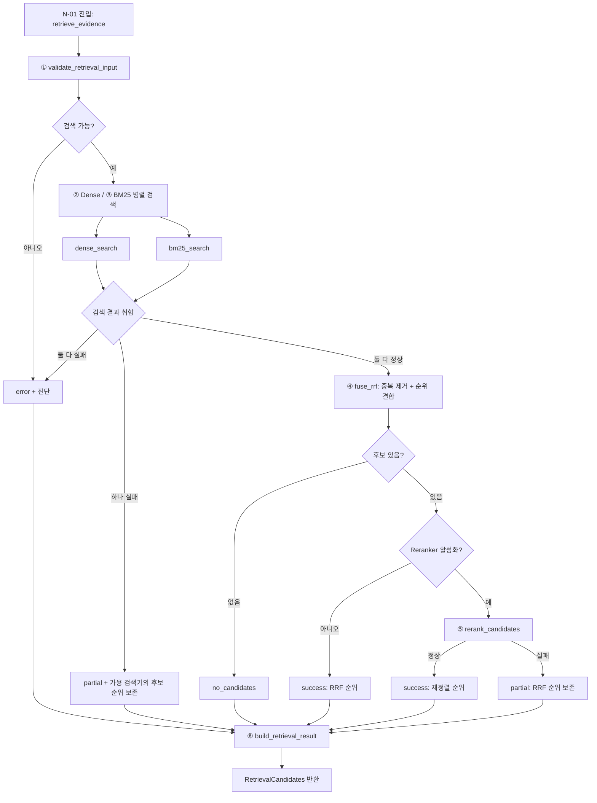

# N-01 · retrieve_evidence — 근거 후보 검색

> **상태:** 함수 구성·입출력·엣지 **설계안 (검토 중, 계약 최종 확정 전)** · 2026-11-01
>
> **위치:** 업무별 호출 방식과 독립적인 공통 검색 Small Node.
>
> **구현 원칙:** LangGraph 실행 노드는 **`retrieve_evidence` 1개**. Dense·BM25·RRF·Reranker는 **내부 Python 함수/검색 모듈**로 다루며, **Tiny Node 계층은 만들지 않는다**. 초기 MVP에서 별도 LLM 호출과 `ToolNode`는 필요하지 않다.

관련 문서: [Small Node LIST](../query-agent-node-list.md) · [Small Node 목록](README.md) · [문서 검색 파이프라인](../document-pipeline.md) · [명칭 기준](../naming-conventions.md)

## 1. 책임과 경계

**단일 책임:** 전달받은 `search_text`를 **허용된 문서·색인 범위**에서 검색하고, 재현 가능한 **후보 ID·순위·출처 참조·실행 상태**를 `RetrievalCandidates`로 반환한다.

**담당:**
- 요청된 범위·색인의 유효성 검사, Dense/BM25 후보 검색
- RRF로 순위 통합 및 동일 청크 중복 제거, 선택적 Reranker 적용
- 검색 메타데이터·색인/모델/설정 버전과 부분 실패 기록
- 후보를 N-02가 원문으로 추적할 수 있도록 참조 보존

**비담당:**
- 파싱·OCR/VLM·청킹·임베딩·색인 *생성* (사전 문서 처리 단계)
- 표·각주 등 원문 문맥 보강(**N-02**), 답변/기준 판정/비교, 주장·인용 검증(**N-03**)
- 사용자 요청의 Big Node 선택(**N-10**), 답변 출력(**N-11**)
- 자율적 질의 증폭(PRF/Multi-query/HyDE), 자유 Tool 호출, 무제한 재시도

**주의:** 검색에서 후보가 없다는 사실은 문서에 해당 내용이 *없다는 증거*가 아니다.

## 2. 필요한 함수 목록

| 구분 | 함수(가칭) | 입력 | 출력·책임 | LangGraph 노드인가? |
|---|---|---|---|---|
| **진입점** | `retrieve_evidence(state)` | LangGraph 상태의 검색 요청·범위·설정 | 내부 검색 단계 호출 후 `RetrievalCandidates`를 상태에 기록 | **예: N-01 하나** |
| ① 입력 검사 | `validate_retrieval_input(request, indexes)` | 검색 문구, 문서/버전 범위, 색인 참조, 설정 | 유효성 결과. 범위 밖·색인 누락/불일치 시 검색 중단 | 아니오 · 내부 함수 |
| ② 의미 검색 | `dense_search(search_text, scope, profile)` | 질문, 허용 범위, Dense 색인/임베딩 설정 | `DenseHit[]`: 청크 ID, 점수, Dense 순위 | 아니오 · 내부 함수/어댑터 |
| ③ 어휘 검색 | `bm25_search(search_text, scope, profile)` | 질문, 허용 범위, BM25 색인/토큰화 설정 | `BM25Hit[]`: 청크 ID, 점수, BM25 순위 | 아니오 · 내부 함수/어댑터 |
| ④ 후보 통합 | `fuse_rrf(dense_hits, bm25_hits, profile)` | 두 검색 목록과 RRF 설정 | 청크별 중복 제거·RRF 순위/점수, 원 검색기별 메타데이터 | 아니오 · 내부 함수 |
| ⑤ 선택적 재정렬 | `rerank_candidates(search_text, candidates, profile)` | 질문과 RRF 후보, 사용 허용된 Reranker 설정 | 최종 순위/점수. 비활성화면 호출하지 않음 | 아니오 · 내부 함수/어댑터 |
| ⑥ 출력 표준화 | `build_retrieval_result(candidates, diagnostics, profile)` | 후보/순위, 실행 상태, 오류, 색인 버전 | `RetrievalCandidates` 최종 구조 구성 | 아니오 · 내부 함수 또는 단순 조립 로직 |

- **필요 함수 7개**(N-01 진입점 1 + 내부 함수/어댑터 6)를 **설계 경계**로만 제안한다. 실제 구현에서는 단순 결과 조립을 진입점 내부에 포함해도 된다.
- Dense/BM25는 **병렬 실행 가능**하되, 병렬화 자체가 새 LangGraph 노드를 요구하지 않는다.
- `DenseHit`/`BM25Hit`는 내부 표현 예시이며 외부 공개 데이터 계약으로 고정하지 않는다.
- 입력·출력 타입명과 함수 시그니처는 **코드 구현 시 조정 가능**하다. 여기서는 함수의 책임과 호출 순서를 정리한다.

## 3. N-01 내부 함수 실행 흐름

**아래 각 박스는 LangGraph 노드가 아닌 함수 호출·조건 검사**다.

**부분 실패에 관한 초안 정책:**
- Dense 또는 BM25가 하나만 실패하면, 성공한 검색기의 후보를 **`partial`로 반환**한다. **이때 두 검색 결과가 없는 상태에서 RRF를 정상 통합한 것처럼 기록하지 않는다.** Reranker 호출은 기본적으로 건너뛰는 안을 우선 검토한다.
- Reranker가 실패했을 때 이미 확보한 RRF 후보를 폐기하지 않고 **`partial` 상태 + RRF 순위**를 반환하는 폴백을 검토한다.
- 부분 결과를 계속 사용할지는 **상위 호출자**가 결정한다. N-01이 답변 가능 여부를 판정하지 않는다.

## 4. 입력 계약 초안

| 필드 | 구분 | 의미 및 요구사항 |
|---|---|---|
| `search_text` | **필수** | 원본 질문 또는 사용자 기준·비교 항목에서 파생된 **명시적 검색 대상 텍스트**. 임의의 새 질문 생성 금지 |
| `document_scope` | **필수** | 허용된 논리 문서 ID·버전 및 필요한 범위 제한. 검색기 양쪽에 **강제 적용**하고 최종 반환 후보에서도 재검사 |
| `request_ref` | **실행 문맥** | 검색을 발생시킨 원 요청·항목의 참조 ID. 입력 추적용 |
| `retrieval_profile` | **필수 설정 참조** | Dense/BM25 색인, RRF 상수·후보 수, 선택형 Reranker 사용 여부/버전·Top-k·예산 등 승인된 설정 ID/버전. 구체 숫자 미정 |

**상위 전제:** 원문 문서와 청크·Dense/BM25 색인은 이미 준비되어 있다. N-01은 그 아티팩트를 재생성하지 않는다. 권한이 없는 문서나 버전이 다른 색인으로 조용히 검색 범위를 확대하지 않는다.

## 5. 출력 계약 초안: `RetrievalCandidates`

| 필드 | 의미 |
|---|---|
| `request_ref` / `query_ref` | 어떤 요청·검토 기준·비교 대상의 결과인지 식별 |
| `candidates[]` | 순위가 매겨진 검색 후보 목록(0개 가능) |
| 후보별 `chunk_id` · `document_id` · `document_version` | N-02가 원문을 찾을 때 사용할 식별자 및 버전 |
| 후보별 `rank` · `score_metadata` | 최종 순위와 Dense/BM25 원순위·점수, RRF 점수/순위, 사용 시 Reranker 점수/순위. **점수 척도를 섞어 직접 비교하지 않음** |
| `index_refs` · `strategy_version` | 검색에 사용한 색인과 프로필/전략 버전. 후보 간 색인/버전이 일치하는지 확인 |
| `status` · `diagnostics` | `success` / `no_candidates` / `partial` / `error`, 단계별 실패·스킵 사유·지연 등 |

**계약 경계:** `RetrievalCandidates`는 **검색 후보**에 대한 결과이며 **원문 보강이 끝난 `EvidenceBundle`이 아니다**. N-02가 후보 참조를 원문 문단·표·헤더·각주·위치와 결합해 `EvidenceBundle`을 만든다. 기존 문서 처리 파이프라인의 '검색 결과 전달 시 EvidenceBundle' 표현은 추후 계약 통일 시 이 경계에 맞춰 정리해야 한다.

**식별자 주의:** JM 브랜치의 PyMuPDF 데모는 PDF 원문 해시 기반 `doc_id`/`version_sha256`/`block_id`를 제공한다. **파서의 `block_id`는 검색 청크의 `chunk_id`와 다르다.** 청킹·문서 등록 계층에서 논리 문서 ID/버전과 청크-원문 블록 매핑을 만든 뒤 N-01에 제공해야 한다. N-01에서 파서 출력 구조에 직접 의존하지 않는다.

## 6. 검색 상태·실패 처리

| `status` | 발생 조건 | 처리 원칙 |
|---|---|---|
| `success` | 필요한 검색기·활성 Reranker가 정상 처리되고 후보가 있음 | 정상 후보 반환 |
| `no_candidates` | **정상 검색은 완료**했지만 허용 범위에 후보가 없음 | 빈 목록 반환. 내용 부재의 증거로 판단하지 않음 |
| `partial` | 검색기 중 일부 실패 또는 Reranker 실패 등으로 제한된 후보만 확보 | 가용 후보·원래 검색 순위·실패 원인 기록. 사용 여부는 Big Node 판단 |
| `error` | 필수 입력·권한·색인 불일치 또는 검색 단계가 모두 실패해 정상 수행 불가 | 후보 없음, 실행 실패 원인 보존. 권한 범위 완화 금지 |

- 재시도 횟수·지연 예산·색인 스냅샷 정책은 아직 **미확정**이다. 기본 설계에 자율 무한 재검색을 넣지 않는다.
- `status`는 **검색 수행 상태**이지 문서 내용의 진위나 업무별 평가 판정이 아니다.
- 원문·비밀 정보 전체를 진단 로그에 복제하지 않고 필요한 식별자/상태/버전만 기록한다.

## 7. 최소 검증·테스트 항목

| 테스트 | 기대 결과 |
|---|---|
| 정상 Dense/BM25 검색 | 동일 `chunk_id` 중복 제거, RRF 최종 순위·원 검색기 순위 기록 |
| 두 검색 모두 후보 없음 | `no_candidates` / 빈 `candidates[]` |
| Dense만 실패 또는 BM25만 실패 | `partial` / 성공한 검색기 후보 보존 / 실패 사유 표시 |
| Reranker 비활성 | RRF 순위 그대로 출력, Reranker 호출 없음 |
| Reranker 타임아웃·실패 | `partial` / RRF 순위 복구, 오류 기록 |
| 입력 문서 권한·버전 불일치 | 검색 중단 또는 범위 외 후보 차단, `error` |
| 동일 질의 + 같은 색인/프로필 버전 | 결과·중간 순위 재현 가능 (비결정적 검색기가 있다면 한계 기록) |
| N-02 연동 | 반환된 `chunk_id`/문서 버전으로 원문 블록·페이지를 정확히 찾을 수 있음 |

## 8. 최종 결정 전 남은 항목

- Dense/BM25 각 후보 수, 최종 Top-k, RRF 상수와 가중치
- Reranker 기본 활성 여부·로컬 모델·실행 비용
- 부분 실패 시 호출자 측 진행 허용 조건 및 제한적 재시도
- `RetrievalCandidates` 실제 Python 타입·필드 제약·아티팩트 저장 형식
- 문서 논리 ID/버전/청크 ID와 파서 원문 블록 매핑, 인덱스 스냅샷 일치 규칙

**여기까지는 'N-01 필요 함수와 실행 흐름'의 문서화다. 코드 구현 완료, 검색 성능 입증 또는 N-01 세부 계약의 최종 확정을 뜻하지 않는다.**
