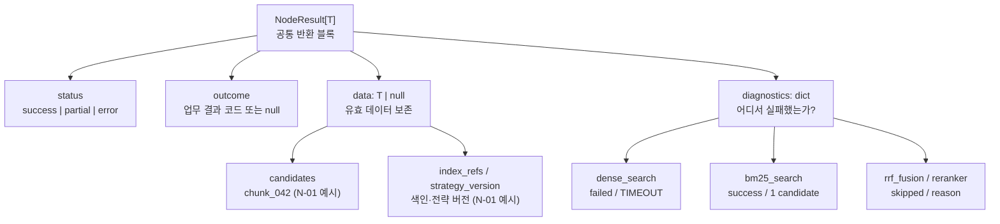

# Small Node 공통 반환 계약 — NodeResult[T]

> **상태: 확정 (2026-11-01).** Small Node N-01~N-11의 **공통 반환 형식**에 적용한다.
>
> **범위:** 결과 데이터, 실행 상태, 단계별 진단, 업무상 결과를 기록하는 **반환 블록**. 개별 노드의 함수·검색 설정·업무 데이터 스키마·Big Node 조건부 엣지는 각 문서에서 정의한다.
>
> 관련 문서: [Small Node 목록](README.md) · [N-01](N-01.md) · [전체 LIST](../query-agent-node-list.md)

## 1. 결정: 공통 반환 4개 필드

모든 Small Node는 `NodeResult[T]` 형태로 반환한다. `T`는 해당 노드의 결과 타입(예: `RetrievalCandidates`, `EvidenceBundle`)이다.

| 필드 | 타입(개념) | 반환 키 | 역할 |
|---|---|---|---|
| `status` | `"success" \| "partial" \| "error"` | **필수** | 노드의 전체 **실행** 상태 |
| `data` | `T \| null` | **필수** (값은 `null` 허용) | 확보한 유효한 업무 결과. 부분 실패 시에도 안전한 결과(빈 목록 가능) 보존 |
| `diagnostics` | `dict[str, StepDiagnostic]` | **필수** (`{}` 허용) | 내부 단계별 실행·실패·생략 정보와 사유 |
| `outcome` | `str \| null` | **필수** (값은 `null` 허용) | 실행 성공/실패와 별개인 **업무상 판단·결과** |

`NodeResult[T]`는 **프로젝트 자체 계약**이며 LangGraph의 내장 노드나 별도 Tiny Node가 아니다. 각 Small Node의 LangGraph 함수는 이 결과를 해당 State 필드에 저장할 수 있다.

**반환과 영속 저장은 별개**다. MVP에서 [H-02 아티팩트 캡처](../artifact-capture.md)를 구현 대상으로 두어 필요한 실행에서 반환 블록을 하네스가 기록한다. Checkpointer는 미정이며 도입하지 않더라도 공통 4필드 계약은 바뀌지 않는다.

### `status`의 의미

| 실행 상태 | 의미 | `data` 취급 |
|---|---|---|
| `success` | 필수·활성 처리 단계 정상 완료 | 정상 데이터(0건 가능) 반환 |
| `partial` | 일부 내부 단계는 실패했으나 **정상 완료된 단계의 결과를 안전하게 반환 가능** | 유효한 `data` 보존. 검색 후보 같은 결과 목록은 **0개여도 가능**하며 실패 위치를 기록 |
| `error` | 필수 단계 전부 실패, 입력/권한/버전 검증 실패 등으로 **안전한 결과 제공 불가** | 원칙적으로 `data: null`. 실패 원인 반환 |

**N-01 확정 규칙:** Dense·BM25가 **모두 정상 완료**하고 후보가 0개면 `status=success`, `outcome=no_candidates`, `data.candidates=[]`이다. **한 검색기가 실패하고 다른 검색기가 정상 완료했으나 후보가 0개인 경우에도** `status=partial`, `outcome=null`, `data.candidates=[]`로 반환한다. 완료된 검색의 **빈 목록도 유효한 부분 결과**이며, 실패한 검색기를 실행하지 못했으므로 `no_candidates`로 단정하지 않는다. 두 검색기가 모두 실패하면 `status=error`와 원칙적으로 `data=null`이다. MVP에서는 정상적인 빈 검색 범위를 별도 `empty_scope` 코드로 구분하지 않는다. **후보 0개는 원문 내용 부재의 증명이 아니다.**

의도적으로 꺼 둔 선택 기능이 `skipped`였다는 사실만으로 전체 상태를 `partial`로 만들지는 않는다. 이 규칙은 **N-01의 검색 후보 유무**와 **모든 Small Node의 실행 상태**를 혼동하지 않도록 적용한다.

## 2. 반환 블록 시각화

이 그림은 **데이터 필드의 포함 관계**를 나타내며 그래프 실행 노드나 조건부 엣지를 뜻하지 않는다.



**N-01 부분 실패를 블록으로 보면:**

```text
NodeResult[RetrievalCandidates]
├── status: "partial"                 ← 노드 전체 상태
├── outcome: null                    ← 별도 업무 결과 없음
├── data:                            ← 정상 확보한 후보는 보존
│   ├── candidates: [chunk_042]
│   ├── index_refs: {dense, bm25}
│   └── strategy_version: "hybrid-rrf-v1"
└── diagnostics:                     ← 단계별 상태·실패 위치
    ├── dense_search: failed / TIMEOUT
    ├── bm25_search: success / 1 candidate
    ├── rrf_fusion: skipped / DENSE_FAILED
    └── reranker: skipped / PARTIAL_SEARCH
```

## 3. 단계별 진단 딕셔너리

`diagnostics`는 **내부 단계명을 키로 하는 딕셔너리**다. 예를 들어 `dense_search`와 `bm25_search`가 각각 무엇을 반환했는지 구분한다.

| 단계의 필드 | 허용값·용도 |
|---|---|
| `status` | `success` / `failed` / `skipped` (노드 전체 `status`와 별개의 상태 집합) |
| `error_code` | 기계가 판단할 오류 코드. 예: `TIMEOUT` |
| `reason` | 실패나 생략 이유를 설명하는 짧은 코드·안전한 메시지 |
| `retryable` | 재시도 가능성 힌트 (`true` / `false` / `null`). 실행 여부는 호출자가 판단 |
| `count` 등 | 필요 시 결과 건수·지연시간 등 비민감 선택적 정보 |

**확정 범위:** 공통 4개 키, 실행 상태 분류, 딕셔너리 기반 단계 식별·오류 기록. **추후 확정:** 개별 단계별 전체 오류 코드 목록과 선택적 진단 필드, 재시도 정책.

보안·무결성 오류(권한 위반, 유효하지 않은 버전/색인)는 폴백으로 숨기지 않는다. 검증되지 않았거나 허용 범위를 벗어난 데이터는 부분 결과에 포함하지 않는다. 민감한 원문, API 키, 스택 트레이스는 진단값에 그대로 저장하지 않는다.

## 4. 예시 반환값 — Dense 실패, BM25 성공

아래 ID·점수는 **구조 설명용 가상 데이터**다. 여기서 `strategy_version`은 **원래 선택된 검색 전략**을 나타내고, 실제로 RRF를 생략한 이력은 `diagnostics`에 기록한다.

```json
{
  "status": "partial",
  "data": {
    "request_ref": "req_001",
    "candidates": [
      {
        "chunk_id": "chunk_042",
        "document_id": "doc_01",
        "document_version": "sha256:example",
        "rank": 1,
        "score_metadata": {
          "bm25_rank": 1,
          "bm25_score": 7.3
        }
      }
    ],
    "index_refs": {
      "dense": "dense-index-v3",
      "bm25": "bm25-index-v2"
    },
    "strategy_version": "hybrid-rrf-v1"
  },
  "diagnostics": {
    "validate_retrieval_input": {"status": "success"},
    "dense_search": {
      "status": "failed",
      "error_code": "TIMEOUT",
      "retryable": true
    },
    "bm25_search": {"status": "success", "count": 1},
    "rrf_fusion": {
      "status": "skipped",
      "reason": "DENSE_FAILED"
    },
    "reranker": {
      "status": "skipped",
      "reason": "PARTIAL_SEARCH"
    }
  },
  "outcome": null
}
```

- 후보의 `rank`는 **BM25 단독 결과의 순위**다. 실행되지 않은 RRF 점수나 Reranker 점수를 가공해 넣지 않는다.
- 하나의 검색기가 실패해도 사용 가능한 다른 검색기의 후보는 `data`에 유지한다. 후속 단계 진행 여부와 제한적 재시도는 **호출자가 판단**한다.
- `index_refs`는 실제 색인 스냅샷/Manifest를, `strategy_version`은 검색 전략 설정을 추적할 수 있는 버전 참조가 되어야 한다.

## 5. 정상 실행했지만 후보가 없는 경우

```json
{
  "status": "success",
  "data": {
    "candidates": [],
    "index_refs": {
      "dense": "dense-index-v3",
      "bm25": "bm25-index-v2"
    },
    "strategy_version": "hybrid-rrf-v1"
  },
  "diagnostics": {
    "dense_search": {"status": "success", "count": 0},
    "bm25_search": {"status": "success", "count": 0},
    "rrf_fusion": {"status": "success", "count": 0},
    "reranker": {"status": "skipped", "reason": "NO_CANDIDATES"}
  },
  "outcome": "no_candidates"
}
```

`no_candidates`는 **색인과 허용 검색 범위에서 찾지 못했다는 뜻**이지 원문 문서에 해당 정보가 없다는 증명은 아니다.

### 부분 실패 + 후보 0개 (N-01 확정 예시)

Dense 검색에 실패했고 BM25 검색은 정상 완료됐지만 후보가 없을 때에도 `data`는 `null`이 아닌 **유효한 빈 후보 목록**을 포함한다.

```json
{
  "status": "partial",
  "data": {
    "request_ref": "req_001",
    "candidates": [],
    "index_refs": {
      "dense": "dense-index-v3",
      "bm25": "bm25-index-v2"
    },
    "strategy_version": "hybrid-rrf-v1"
  },
  "diagnostics": {
    "dense_search": {"status": "failed", "error_code": "TIMEOUT"},
    "bm25_search": {"status": "success", "count": 0},
    "rrf_fusion": {"status": "skipped", "reason": "DENSE_FAILED"},
    "reranker": {"status": "skipped", "reason": "PARTIAL_SEARCH"}
  },
  "outcome": null
}
```

**`empty_scope`는 MVP 결과 코드에 포함하지 않는다.** 정상 검색 범위가 실제로 비어 있는 경우와 정상 검색 후 후보를 못 찾은 경우 모두 `success/no_candidates`가 가능하다. 반면 인덱스 누락·권한 위반·버전 불일치는 검색 오류이므로 `no_candidates`로 처리하지 않는다.

## 6. N-01~N-11 적용 원칙

| Small Node | `data`의 업무 타입(예시) | 실행/업무 결과 구분 |
|---|---|---|
| N-01 | `RetrievalCandidates` | 검색 정상 + 후보 없음 = `status: success`, `outcome: no_candidates` |
| N-02 | `EvidenceBundle` | 일부 원문 조회 실패 + 나머지 안전한 근거 보존 = `partial` |
| N-03 | `VerificationReport` | 검증은 정상 실행했지만 근거 부족 = 실행 `success` / 업무상 '근거 부족' |
| N-06 | `CriterionFinding` | '기준 미충족'은 실행 오류가 아닌 업무상 결과 |
| N-09 | `ComparisonFinding` | '비교 불가능'은 실행 오류와 구별 |
| N-10 / N-11 | `RoutedTask` / 사용자 결과 등 | 실행 전 종료·전달 결과도 동일한 공통 외피로 취급 |

- **전체 11개 Small Node에 공통 적용**한다. `data` 안의 정확한 필드와 `outcome` 코드 목록은 노드별 상세 계약에서 따로 확정한다.
- 상위 처리에서 `status`와 `diagnostics`를 사용하되, 공통 반환 계약 안에 업무별 Small Node 연결이나 조건부 엣지를 정의하지 않는다.
- 노드/함수의 개수를 늘리지 않으며 Tiny Node 계층을 추가하지 않는다.

## 7. 공통 테스트 체크리스트

1. 정상 실행 + 선택적 단계 `skipped`: `status=success` 허용
2. 모든 필수 검색 단계 정상 완료 + 빈 결과: `status=success`, `outcome=no_candidates`, `data.candidates=[]` (N-01 예시)
3. 일부 단계 실패 + 안전한 부분 결과: `partial`, `data` 보존(검색 후보 `[]` 가능), 실패 단계/원인 명시
4. 모든 필수 단계 실패 또는 권한/버전 오류: `error`, 위험한 `data` 반환 금지
5. 업무상 결과인 '미충족·근거 부족·비교 불가능'을 실행 `error`와 혼동하지 않기
6. 직렬화 시 **`status` / `data` / `diagnostics` / `outcome` 네 키 모두 포함**(`data/outcome=null`, `diagnostics={}` 허용)

**결정 경계:** 공통 반환 외피와 상태 의미, N-01의 후보 0건·부분 실패 분류는 **확정**했다. 각 Small Node의 세부 `T` 스키마·업무별 결과 코드·실제 타입 구현과 테스트 결과는 **아직 확정되지 않았다**.
