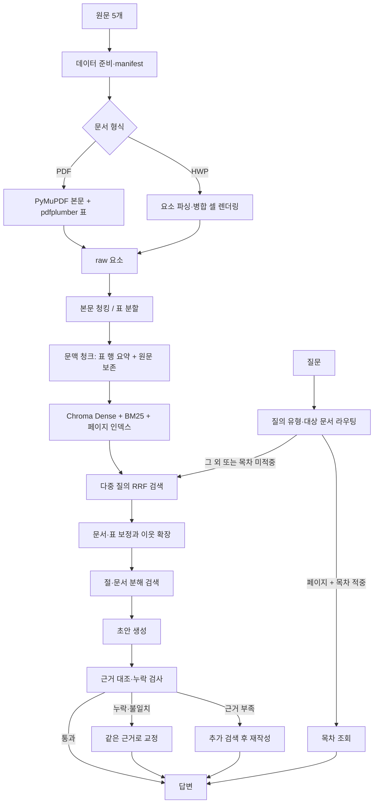

# baseline-1 파이프라인 구조

baseline-1은 Git tag `v23`, commit `64ac263b19143fcbb9ea981f1c3b169dd0c056c1`의 파이프라인을 기준으로 한다. 줄 번호는 보존 사본 [legacy/build_notebook_v23.py](../../legacy/build_notebook_v23.py)를 가리킨다.

## 흐름

## 단계와 구현 위치

| 단계 | 동작 및 주요 함수 | 보존 사본 |
|---|---|---|
| 입력·실행 환경 | `load_api_key`, `required_files`, `build_document_manifest`, `prepare_dataset`; 필수 원문 다섯 개를 고정 순서로 확인하고 SHA-256·크기·파서 버전을 기록 | `:59–298` |
| 파싱 | `parse_hwp`는 HWP 요소와 셀 JSON을 읽고 rowspan/colspan을 markdown 표로 렌더링한다. `parse_pdf`는 PyMuPDF로 본문, pdfplumber로 표를 읽는다. `normalize`, `rows_to_markdown` 공통 정규화를 적용한다 | `:299–430` |
| 청킹 | 본문은 `RecursiveCharacterTextSplitter`(800자, 겹침 100자), 표는 헤더를 반복해 최대 1,400자 조각으로 나눈다. 각 조각에 파일명·페이지 접두사와 `part`, `chunk_id`를 둔다 | `:431–493` |
| 색인 텍스트 구성 | `build_contextual_chunks`가 제목·페이지·종류와 표 행 요약을 색인 텍스트 앞에 붙이고, 원문은 `metadata.raw`에 보존한다 | `:494–678` |
| 색인 | `korean_tokenizer`로 형태소를 추출한다. 청크 Chroma(Dense, cosine)와 BM25, 같은 문서·페이지의 원문을 모은 페이지 Chroma/BM25 인덱스를 만든다. 목차 후보 페이지는 본문 줄 패턴으로 자동 탐지한다 | `:679–766` |
| 라우팅 | `route_query`가 `schedule/page/table/procedure/eligibility/list/general` 중 하나를 정하고, `target_doc`가 문서 키워드에 따라 대상 문서를 찾는다 | `:767–870` |
| 검색 | `_retrieve_impl`은 원문·키워드·경로 접미어 검색을 RRF로 합친다. 희귀어 BM25, 페이지 prior, 대상 문서·표 종류별 boost를 적용하고 Dense 1위를 보존한다. 상위 청크의 이웃과 같은 페이지의 관련 청크를 확장한다. `retrieve_multi`는 복합 질문의 절·문서별 검색을 합친다 | `:871–1141` |
| 답변·검증 | `ask`는 목차 답변 또는 검색 → 초안 → `ground_answer` 및 목록·조건·인접 정보 검사 → 필요 시 추가 검색 또는 같은 근거 교정을 실행한다. 반환용 `metadata.raw`가 LLM 근거다 | `:1142–1585` |

## 검색·답변 동작

1. 질문을 라우팅하고 대상 문서를 추정한다. `page` 경로에서 목차 항목을 찾으면 LLM 호출 없이 해당 페이지 정보를 반환한다.
2. 나머지는 BM25와 Dense 검색을 결합한다. 원문 질의, 키워드 질의, 키워드와 라우트 접미어를 붙인 Dense 질의를 RRF로 융합하고, 희귀 토큰·페이지 prior·라우트에 맞는 가중치를 더한다.
3. 검색 결과가 복합 질문의 모든 부분을 덮도록 하위 질의를 병렬 검색한다. 같은 문서 내 이웃 청크와 같은 페이지의 관련 조각도 확장한다.
4. 초안 답변을 근거와 대조한다. 근거가 부족하다고 답한 경우에는 키워드 추가 검색 후 재작성한다. 사실·인용·목록·조건·행의 세부정보가 맞지 않으면 같은 근거로 교정한다. 시간 여유가 없으면 초안을 유지한다.

## 시간 예산

`ask` 시작 시 만든 하나의 마감 시각을 검색, 분해 검색, 추가 검색과 LLM 호출에 전달한다. `HARD_LIMIT=18.0`초이며, `REPAIR_START_LIMIT=9.0`초 이후에는 추가 검색·교정을 시작하지 않는다. 새 단계를 시작하려면 잔여 시간이 `MIN_STAGE_SECONDS=1.0`초 이상이어야 한다. LLM 객체의 기본 `timeout=20`초보다 요청 단위 마감 시각이 먼저 적용되고, 재시도는 끈 상태(`max_retries=0`)다. 줄 위치는 `:1405–1448`, 공유 마감 처리는 `:1464–1577`이다.

## 로컬·Colab 실행 구조

- `build_notebook.py`가 공통 원본이다. 실행하면 제출 노트북 `202235052_박진성.ipynb`와 로컬 모듈 `pipeline_v23.py`를 생성한다(`legacy/build_notebook_v23.py:1640–1679`). 생성물의 코드를 직접 수정하는 구조가 아니다.
- Colab 노트북은 설치 셀부터 순서대로 실행한다. 로컬 모듈은 import 시 설정·파싱·색인·연결 예열까지 실행하므로 API 키와 원문 데이터 경로가 준비되어 있어야 한다.
- 키는 환경변수, 선택적 `.env`(`override=False`), Colab Secrets 순서로 읽는다. 필수 `OPENAI_API_KEY`는 없으면 중단하고, Voyage 키는 `VOYAGEAI_API_KEY` 또는 `VOYAGE_API_KEY`를 읽는다. Voyage 키가 없으면 `text-embedding-3-small` 경로를 쓴다(`:79–120`, `:698–701`). 키 값은 파일·문서에 기록하지 않는다.
- 로컬 원문 경로는 `GACHON_DATA_DIR`로 지정한다. 기본값은 `/content/dataset`이며, Colab에서는 기존 zip·Drive·업로드 탐색 경로가 남아 있다(`:147`, `:193–287`).
- 평가 러너는 매 반복마다 파이프라인 모듈을 새로 불러 색인을 준비하고, 응답시간에는 색인 구축을 포함하지 않는다. 저장된 실행은 [README_LOCAL.md](../../README_LOCAL.md)의 평가 절차를 따른다.
