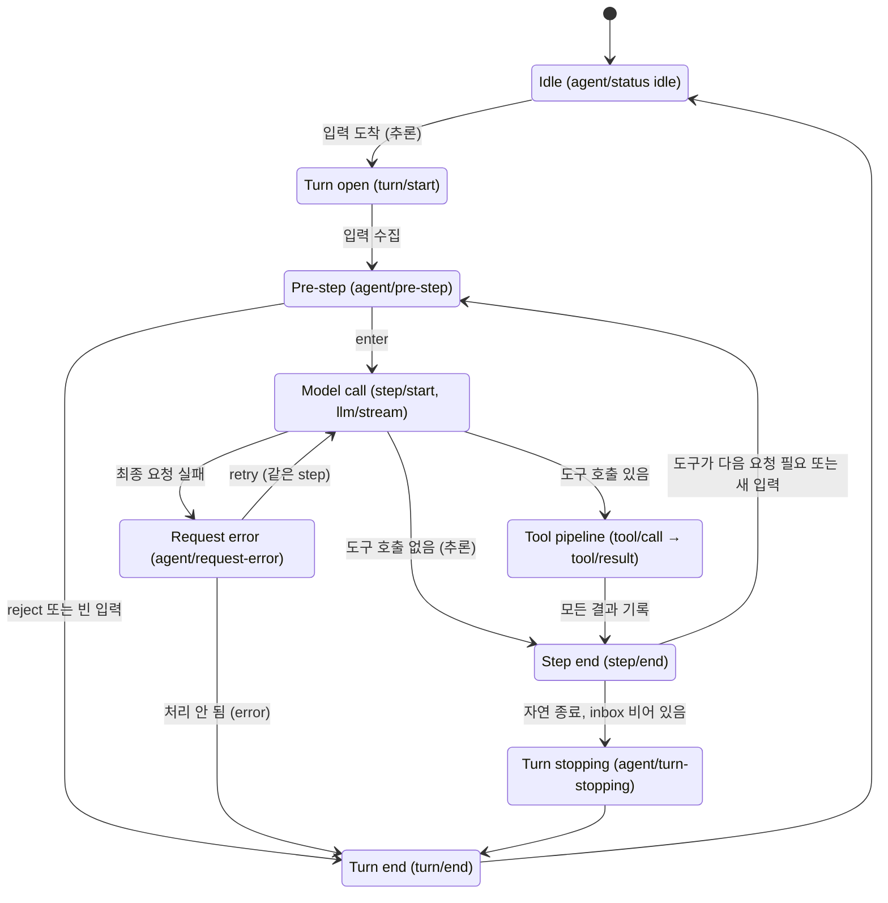
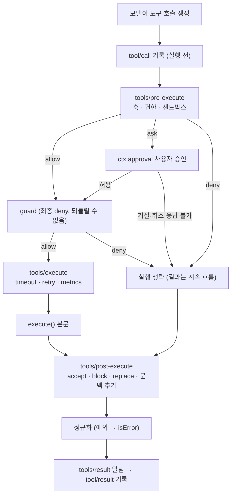

# DeepSeek Harness(DSH) 분석 노트

> 상태: 설계 참고 자료 (ReportAnchor 하네스는 DSH를 참고해 LangChain/LangGraph로 직접 구현. [결정 현황](../../docs/idea-backlog.md#0-결정-현황-2026-10-30))
>
> 조사 시점: 2026-10-30, `deepseek-ai/deepseek-harness` `master` 브랜치 공식 문서 기준. 코드는 직접 실행·확인하지 않았다.
>
> 주의: DSH는 Developer Preview이며 README에 호환성을 깨는 변경이 예고되어 있다. 이벤트 이름·필드는 변경될 수 있다.

**[추론]** 표시는 문서에 명시되지 않아 다른 서술로부터 추론한 내용이다. 표시가 없는 내용은 아래 출처 문서의 서술이다.

## 1. 개요

DSH는 DeepSeek의 오픈소스(MIT) Agent 런타임이다. 모델 어댑터, 도구, 세션 저장, 샌드박스, Agent 루프를 모두 **플러그인**으로 구성하며, 그 밑에 **Cordis**라는 플러그인 프레임워크가 있다. 문서는 "패치해야 하는 특권 코어가 없다"고 설명한다. Web UI, 헤드리스 CLI, Python SDK, ACP 형태로 실행된다.

ReportAnchor 관점에서 참고할 핵심은 네 가지다.

1. **턴/스텝 상태 머신**: Agent 루프를 turn과 step으로 나누고, 단계마다 확장 지점(이벤트)을 둔다.
2. **도구 실행 파이프라인**: 인자 검증 → 권한·승인 → 실행 → 결과 정규화까지 단일 경로로 처리한다.
3. **세션 = append-only 이벤트 로그**: 모델이 본 모든 것을 로그에 남기고, 대화 내역은 로그에서 다시 만든다.
4. **플러그인 경계**: 기능은 서비스로 제공하고, 개입·정책은 이벤트로 처리한다.

## 2. 구성 요소

### 2.1 Cordis와 플러그인

- 플러그인은 `inject`(필요한 서비스 목록)와 `apply(ctx)`를 가진 함수 또는 `Service` 클래스다. 로드 순서는 수동 부팅 순서가 아니라 서비스 의존 관계로 정해진다.
- 공유 컨텍스트 `ctx.<key>`에 서비스가 등록된다.
- 모든 등록은 해제 함수(disposer)를 가져야 하며, 플러그인을 내리면 등록한 도구·리스너도 함께 해제된다.
- 이벤트 디스패치 방식: `emit`, `waterfall`(미들웨어처럼 `next()` 호출), `parallel`, `serial`, `bail`. 방식 자체가 이벤트 계약의 일부다.
- 원칙: **개입과 정책은 이벤트로, 직접 기능 호출은 서비스 메서드로.**

### 2.2 핵심 패키지

| 패키지 | 컨텍스트 키 | 역할 |
|---|---|---|
| core/session | `ctx.sessions` | append-only `SessionEvent` 로그와 메모리 저장소 |
| core/system-prompt | `ctx.systemPrompt` | 프롬프트 섹션과 도구 스키마 조립 |
| core/tools | `ctx.tools` | 범위가 지정된 도구 레지스트리와 보호된 실행 파이프라인 |
| core/agent | `ctx.agents` | Agent 인터페이스, 실행 중 레지스트리, `agent/*` 이벤트 |
| core/agent-loop | `ctx.agentLoop` | 위 인터페이스의 기본 구현(드라이버) |
| core/scope | — | Agent별 범위 등록 기본 요소 |
| llm/llm | `ctx.llm` | 메시지·스트림 형식과 모델 어댑터 경계 |

그 밖의 기능 키: `ctx.shell`, `ctx.subprocess`, `ctx.fs`, `ctx.sandbox`, `ctx.approval`, `ctx.jobs`(장시간 작업), `ctx.commands`, `ctx.goals` 등.

### 2.3 프로필과 번들

- **번들**: 배포 단위. `dsh-base`가 공통 첫 계층으로 모델 어댑터, 도구, 영속화, 샌드박스·승인 정책, 설정, 자격 증명, 텔레메트리를 담는다.
- **프로필**: 번들 조합에 이름을 붙인 것. 기본 제공: `web`, `headless`, `sdk`, `sdk-minimal`, `acp`.
- 설정은 프로필의 번들 → `cordis.patch.yml` → 홈 패치 → `--patch` 순으로 덮어쓴다.

### 2.4 이벤트의 세 영역

| 영역 | 예 | 성격 |
|---|---|---|
| 세션 이벤트 | `turn/start`, `assistant/message`, `tool/result` | 영속. `session/event`로 방송 |
| Agent 이벤트 | `agent/status`, `agent/pre-step`, `agent/request-error` | 실행 중 조정용 |
| 기능 이벤트 | `fs/*`, `tools/*`, `telemetry/*` | 도구·파일 등 기능 단위 |

UI와 SDK는 `session/event`를 기준으로 화면을 그리도록 권장된다.

## 3. Agent 루프

### 3.1 용어

- **step**: 모델 요청 1번과 그 요청이 부른 도구 호출들.
- **turn**: step 0개 이상. 첫 입력을 가져오기 전에 열리고, 더 처리할 것이 없을 때 닫힌다.

### 3.2 상태 머신



`agent.cancel()`은 어느 상태에서든 현재 작업을 중단하고 turn을 `aborted`로 닫는다(그림에서는 생략).

### 3.3 단계별 흐름

1. `Agent.followup(content)`로 입력이 inbox에 들어가면 드라이버가 깨어나 `agent/status running`을 낸다.
2. `turn/start`: 대기 중인 입력을 가져온다(`agent/inbox/claimed`).
3. 컨텍스트 조립: step마다 도구 목록을 한 번 확정하고, `system-prompt/assemble`로 시스템 프롬프트를 만들며, 모델 선택을 고정한다.
4. `agent/pre-step`: 리스너가 거절(reject)하거나 메시지를 넣는다(enter). 거절되거나 첫 입력이 비어 있으면 step 없이 turn을 닫는다.
5. `step/start` → 요청 준비(`prepareCall`). 이 비동기 단계에서 취소되면 아무것도 로그에 기록하지 않는다.
6. 동기 기록: `system/message`, `user/message`, `request/header`, `request/context`를 로그에 쓰고, 요청을 **로그에서 다시 만들어 고정**한다.
7. `llm/stream`으로 스트리밍한다.
   - 성공: `assistant/message` 기록 (중단 시 `interrupted: true`).
   - 실패: `assistant/attempt` 기록 → `agent/request-error`. 리스너가 `retry`를 반환하면 **같은 step 안에서** 다시 요청한다. pre-step과 사용자 입력 기록은 반복하지 않는다.
8. 도구 호출이 있으면 도구 파이프라인을 거친다(4절). 결과는 모델이 낸 순서대로 기록한다.
9. `step/end`: 이 step의 도구 목록을 해제한다.
10. 다음 요청이 필요하거나 새 입력이 있으면 4로 돌아가고, 아니면 `agent/turn-stopping` → `turn/end {reason}` → `agent/status idle`.

### 3.4 종료와 오류 규칙

- **반복 상한 없음**: 문서는 "기본 turn 예산이 없다"고 밝힌다. 무한 반복을 막으려면 `agent/turn-stopping` 같은 기존 확장 지점에서 취소해야 한다. 요청당 출력 토큰 상한(`maxTokens`)만 있다.
- **플러그인 오류**: 미들웨어·결과 처리·도구 오류는 turn을 닫지만 루프 자체를 죽이지 않는다("plugin failure ends the turn, not the loop").
- **turn 종료 이유(`TurnEndReason`)**: `completed`, `aborted`, `blocked`, `error`, `max-tokens`. 그 밖에 `interrupted`(충돌 복구), `forked`(fork 시작점)는 실행 중에는 나오지 않는다.

## 4. 도구 실행 파이프라인

### 4.1 등록

```ts
export const inject = ['tools']
export function apply(ctx) {
  ctx.tools.register(defineTool({ name, description, parameters, output, execute }))
}
```

- 인자는 `execute` 실행 전에 파라미터 스키마로 자동 검증된다. 출력도 lossless JSON으로 스냅샷·검증·동결된다.
- 스키마는 시스템 프롬프트 조립에 자동 반영된다.
- 플러그인을 내리면 도구 등록도 해제된다. 교체는 기존 등록을 해제하고 새로 등록한다.
- 화면 표시용 `presentCall` / `presentResult`, diff 카드용 `presentationMeta`를 선택적으로 둔다.

### 4.2 흐름



- **승인**: `ctx.approval`이 없거나 응답할 수 없으면 거부로 처리한다.
- **거부된 호출도 결과를 남긴다.** 본문만 건너뛰고 post-execute와 `tool/result`까지 진행해 대화 내역의 짝이 맞는다.
- **병렬 실행**: 배타적 호출은 장벽(barrier)을 만들고, 병렬 가능한 호출은 제한된 풀에서 실행한다. `maxParallelToolCalls` 기본값 10.
- **중단·실패 시 보정 결과**: 취소로 실행되지 않은 호출은 `ABORTED_BEFORE_DISPATCH`, 결과가 없는 호출은 `TOOL_OUTCOME_UNKNOWN`, 기록이 없는 호출은 `TOOL_NOT_STARTED`. 문서는 이것이 **불확실한 작업을 자동으로 재시도하지 않기 위한 장치**라고 설명한다.
- **장시간 작업**: `ctx.jobs.start(...)`로 백그라운드 작업을 만들고 핸들을 돌려준다.
- **파일 변경**: 도구의 파일 쓰기·수정은 `fs/write-intent`, `fs/edit-intent` 이벤트를 거친다.

## 5. 세션

- **세션은 append-only `SessionEvent` 로그이며 유일한 진실 원천**이다. 모델에 보내는 메시지 내역은 따로 저장하지 않고 로그에서 다시 만든다. 원칙: "모델이 본 것은 로그에 있다(Model-visible means logged)."
- **주요 이벤트**: `turn/start`, `turn/end`, `step/start`, `step/end`, `user/message`, `system/message`, `developer/message`, `assistant/message`, `assistant/attempt`, `tool/call`, `tool/result`, `request/header`(`initial`·`resume`·`change`·`series`), `request/context`, `session/end-seed`.
- **생성**: `ctx.agents.create({ sessionId, agentOptions, setup })`. 실패하면 생성 과정을 되돌린다.
- **재개(resume)**: 기존 로그를 읽고, 충돌로 열린 채 끝난 turn에는 닫는 이벤트를 덧붙인 뒤 `request/header`(`resume`)를 남긴다.
- **분기(fork)**: turn 경계에서만 가능하다. 열린 turn 중간에서 자르는 것은 거부한다. 자식 세션에는 `session/end-seed {inherited: true}` 표시가 붙는다.
- **재생(replay)**: 같은 이벤트로 다시 만든다. 모르는 필수 이벤트는 건너뛰지 않고 거부하며, `ignorable: true` 이벤트만 건너뛸 수 있다.
- **저장 형식**: JSONL. `session.jsonl[.zstd]`(v0), `session.vN.jsonl[.zstd]`(v1 이상). 기존 세대 파일은 이름 변경·교체·삭제하지 않고, 버전 이전은 옆에 새 세대를 만드는 방식이다.
- **압축(compaction)**: `compaction/start` · `compaction/summary` · `compaction/end` 이벤트로 기록한다. 원 이벤트를 지우지 않고, 특정 구간을 요약으로 대체하는 표시를 남긴다. 컨텍스트 압박은 `agent/pre-step`에서, 컨텍스트 초과 오류는 `agent/request-error`에서 처리한다.

## 6. ReportAnchor에 주는 시사점

### 6.1 LangGraph 대응 [추론]

| DSH | LangGraph/LangChain에서 대응되는 것 | 비고 |
|---|---|---|
| turn/step 상태 머신 | `StateGraph` 노드와 조건부 엣지 | Pre-step, Model call, Tool pipeline, Step end를 노드로 |
| `agent/request-error` retry | 노드 `RetryPolicy` 또는 오류 분기 엣지 | DSH는 같은 step 안에서만 재시도 |
| `ctx.approval` 승인 | `interrupt()` | 사람 승인 대기·재개 |
| 도구 레지스트리·인자 검증 | LangChain 도구 정의 + `ToolNode` | 거부·보정 결과(`ABORTED_BEFORE_DISPATCH` 등)는 직접 구현 필요 |
| `agent/turn-stopping` 예산 제어 | `recursion_limit`, 상태 카운터 | DSH는 기본 상한이 없음. LangGraph는 recursion_limit 기본 제공 |
| 세션 이벤트 로그 | 체크포인터(상태 스냅샷) | **개념이 다름.** 아래 6.2 참고 |
| 이벤트 기반 확장 | 콜백, 스트림 이벤트, 노드 래퍼 | Cordis 수준의 플러그인 체계는 없음 |

### 6.2 설계에서 정할 것

- **로그 우선 vs 상태 우선**: DSH는 모든 사건을 로그에 쌓고 상태를 거기서 다시 만든다. LangGraph 체크포인트는 시점별 상태를 저장한다. backlog의 저장 계층(Checkpoint · Artifact · Execution Trace)과 결정 현황 5번(저장 기술)에서 둘의 관계를 정해야 한다.
- **반복 상한과 예산**: DSH도 기본값이 없다. 결정 현황 6번(실행 정책)에서 turn당 step 수, 재검색 횟수, 토큰 예산을 정한다.
- **실행 전 기록과 불확실 결과 처리**: `tool/call`을 실행 전에 기록하고, 결과가 불확실한 호출을 자동 재시도하지 않는 방식은 수정·생성 도구(H-10)를 도입할 때 중복 적용을 막는 근거가 된다.
- **거부된 호출도 결과를 남기는 방식**은 판단 보류·미확인 상태를 추적하려는 ReportAnchor 원칙과 맞는다.

## 7. 출처

| 문서 | 내용 |
|---|---|
| [README](https://github.com/deepseek-ai/deepseek-harness) | 개요, 실행 방식, Developer Preview 경고 |
| [architecture.md](https://github.com/deepseek-ai/deepseek-harness/blob/master/docs/architecture.md) | 패키지·컨텍스트 키, 이벤트 영역, turn 흐름, 프로필, fork, 저장 형식 |
| [agent-lifecycle.md](https://github.com/deepseek-ai/deepseek-harness/blob/master/docs/agent-lifecycle.md) | Agent 루프 시퀀스 다이어그램 |
| [tool-execution-pipeline.md](https://github.com/deepseek-ai/deepseek-harness/blob/master/docs/tool-execution-pipeline.md) | 도구 실행 플로우차트 |
| [subsystems/session.md](https://github.com/deepseek-ai/deepseek-harness/blob/master/docs/subsystems/session.md) | 세션 이벤트, 재개·분기·재생, 압축. 문서 후반부는 요약으로만 확인 |
| [agent-loop README](https://github.com/deepseek-ai/deepseek-harness/blob/master/packages/core/agent-loop/README.md) | 드라이버, 반복 상한 없음, 생성·해제 순서, 보정 결과 코드 |
| [cordis-primer.md](https://github.com/deepseek-ai/deepseek-harness/blob/master/docs/cordis-primer.md) | 플러그인·서비스·이벤트 디스패치 방식 |
| [cookbook/adding-a-tool.md](https://github.com/deepseek-ai/deepseek-harness/blob/master/docs/cookbook/adding-a-tool.md) | 도구 등록 계약, 인자·출력 검증 |

**읽지 않은 문서** (후속 확인 대상): `docs/subsystems/` 아래 tools · persistence · compaction · subagent · agent-team, `docs/capability-seams.md`, `docs/event-producer-consumer.md`, `docs/cookbook/extension-cookbook.md`(권한 게이트 예시). 샌드박스 내부 구조, 승인 정책 설정, 서브에이전트 동작은 이번에 확인하지 못했다.
